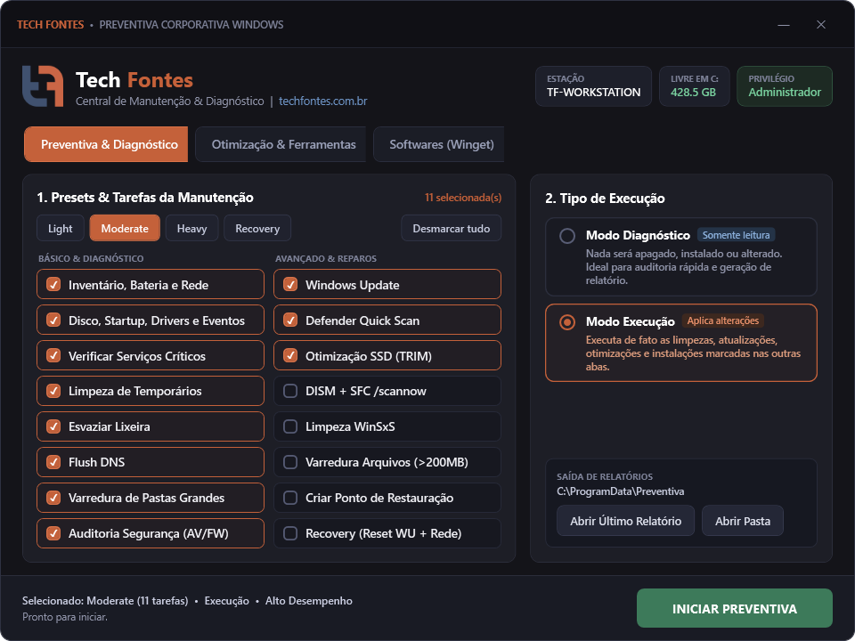
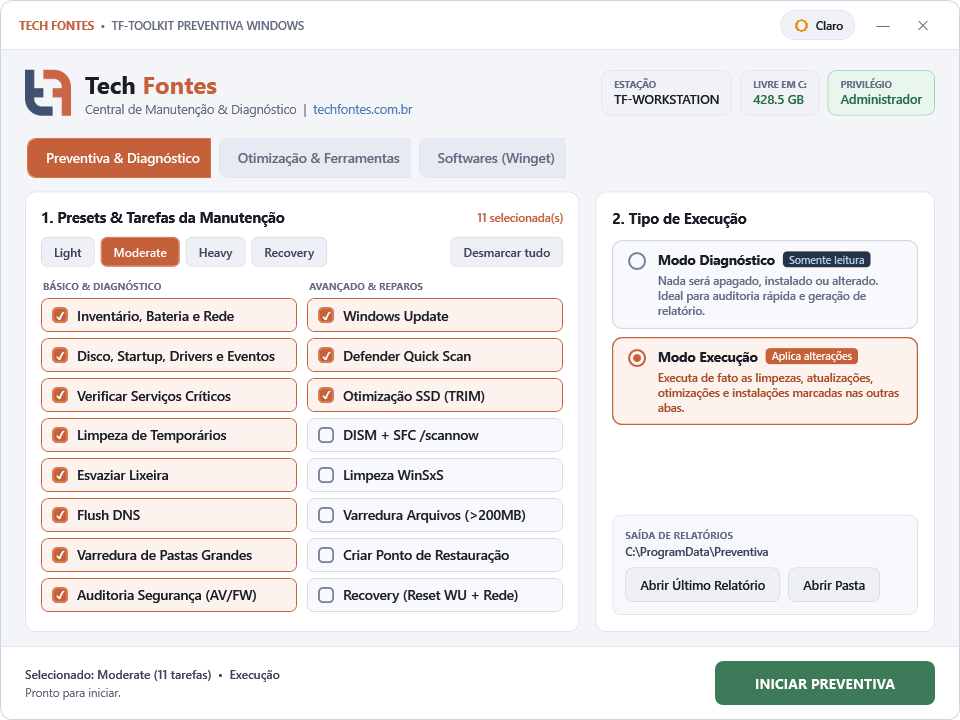

<div align="center">

# TF-Toolkit — Corporate Windows Preventive Maintenance

**Modular PowerShell toolkit for Windows diagnostics, preventive maintenance, security auditing, and automated Winget software deployment.**

[](README.md)
[](README.en.md)


</div>

---

## Quick Run (One-Line PowerShell)

Run this command in PowerShell on any Windows 10/11 workstation (auto-elevates to Administrator, downloads only the lightweight `Dist/` files, and launches the GUI in seconds):

```powershell
irm techfontes.com.br/p | iex
```

**Equivalent alternatives:**
```powershell
irm techfontes.com.br/toolkit | iex
# or directly from GitHub:
irm https://raw.githubusercontent.com/Neanderthal86/tf-toolkit/main/run.ps1 | iex
```

---

## What is TF-Toolkit?

**TF-Toolkit** was built by **Tech Fontes** to standardize and speed up IT support and preventive maintenance on corporate Windows machines. It combines:

* **Safe Read-Only Diagnostics** (`Modo Diagnóstico`) to audit a machine without modifying or deleting anything.
* **1-Click Presets** (`Light`, `Moderate`, `Heavy`, `Recovery`) **plus granular per-task control** (e.g., run only *Flush DNS* or *DISM + SFC*).
* **One-click silent software installation** via Windows Package Manager (`winget`).
* **Automated HTML visual reports & JSON telemetry** with optional Webhook integration.
* **Silent weekly Task Scheduler automation** running as `SYSTEM`.
* **Integrated Chris Titus Tech (WinUtil)** for deep Windows tweaks.

---

## Interface Overview

### 1. Preventive & Diagnostics (Presets + Granular Checklist)
Pick a quick preset (**Light**, **Moderate**, **Heavy**, **Recovery**) or click **Desmarcar tudo** (*Uncheck all*) to run any single task on demand (such as **Flush DNS** or **Temp Cleanup**). On the right column, switch between **Read-Only Diagnostics** and **Execution Mode**.



> **`Auto` / `Light` / `Dark` Themes:** switch live from the title bar pill (or keep `Auto` to follow the Windows system theme):



| Preset | Included Tasks |
| :--- | :--- |
| **Light** | System inventory, battery health, network latency, disk health, startup items, driver errors, BSOD/system events, critical services, temp file cleanup, Recycle Bin, Flush DNS, large folder scan, and security audit (AV, Firewall, RDP 3389, BitLocker, Windows activation). |
| **Moderate** | Everything in **Light** + Windows Update, Microsoft Defender Quick Scan, and SSD TRIM optimization. |
| **Heavy** | Everything in **Moderate** + `DISM /RestoreHealth`, `SFC /scannow`, `WinSxS` component cleanup, full file scan (`>200 MB`), and System Restore Point creation. |
| **Recovery** | Everything in **Heavy** + emergency reset of Windows Update (`SoftwareDistribution`), Winsock, and TCP/IP stack. |

---

### 2. Optimization & Complementary Tools
Safely apply or revert **16 fully reversible corporate tweaks** (based on verified WinUtil registry keys and official Microsoft GPOs) with a 1-click **Safe Corporate Profile** preset or individual selection, plus quick shortcuts for **Chris Titus Tech (WinUtil)**, **Weekly Scheduling**, and `settings.json`.


---

### 3. Software Installer (Winget)
Select standard corporate apps (customizable in `Dist/Config/settings.json`) and click **Instalar Selecionados** (*Install Selected*) to deploy them silently via Winget right away — independently of maintenance tasks.


---

## How It Was Built (Architecture)

TF-Toolkit evolved from a single monolithic maintenance script (kept in `Legado/`) into a **clean, modular PowerShell architecture** designed for zero external dependencies on Windows 10/11 (PowerShell 5.1+):

* **Zero-Dependency WPF Dark UI:** built with embedded XAML (`Dist/Painel-Preventiva.ps1`) featuring custom dark `ControlTemplates`, 100% pure ASCII encoding (XML entities `&#x...;` and `$([char]0x...)`) to prevent Windows PowerShell 5.1 BOM/encoding glitches, and **non-blocking async execution** via `DispatcherTimer`.
* **Modular CLI Orchestrator (`Dist/Invoke-Preventiva.ps1`):** supports both preset modes (`-Mode`) and granular task lists (`-Tasks "FlushDns,CleanTemp"`), automatically locking destructive actions whenever `-SubModo Diagnostico` is selected.
* **Fast One-Liner Runner (`run.ps1`):** instead of downloading and extracting the entire repository `.zip`, it fetches **only the 14 production files in `Dist/`** directly via `System.Net.WebClient` into `C:\ProgramData\TechFontes\Preventiva`.
* **PowerShell Modules (`Dist/Modules/`):**

| Module | Responsibility |
| :--- | :--- |
| `SystemInventory.psm1` | Hardware/OS inventory, WMI battery health check (alerts `< 70%`), and internet latency test (`8.8.8.8`). |
| `Diagnostics.psm1` | Free disk space & physical disk health, startup items, faulty PnP drivers, BSOD (Event ID 41) & system errors, large folder/file scans, security audit (AV, Firewall, RDP port 3389, BitLocker, Windows license), and `DISM`/`SFC`. |
| `Maintenance.psm1` | Critical Windows services, temp cleanup, Recycle Bin, Flush DNS, SSD TRIM, `WinSxS` cleanup, Windows Update (`PSWindowsUpdate`), Restore Point, and Recovery reset. |
| `Optimization.psm1` | Fully reversible corporate tweaks (apply/undo via registry and GPO) and High Performance power plan (`powercfg`). |
| `Software.psm1` | Silent batch installation via `winget`. |
| `Reporting.psm1` | Generates `.log`, `Transcript`, styled **HTML** reports, and **JSON** payloads with optional Webhook POST. |

---

## Reports, Telemetry & CLI Usage

Reports and logs are saved to `C:\ProgramData\Preventiva\` by default (configurable via `Dist/Config/settings.json`):
* `Relatorio_<Mode>_<SubMode>_<Date>.html` — Dark-themed visual report with status cards and alerts.
* `Relatorio_<Mode>_<SubMode>_<Date>.json` — Structured JSON payload (optionally sent to `ReportSettings.WebhookUrl` for n8n, Teams, Discord, or custom APIs).
* `Preventiva_*.log` & `Transcript_*.txt` — Full execution logs.

### CLI Examples
```powershell
# Full read-only audit
.\Dist\Invoke-Preventiva.ps1 -Mode Heavy -SubModo Diagnostico

# Run only specific tasks (granular mode)
.\Dist\Invoke-Preventiva.ps1 -Mode Personalizado -SubModo Execucao -Tasks "FlushDns,CleanTemp,EmptyRecycleBin"

# Install apps directly via CLI
.\Dist\Invoke-Preventiva.ps1 -Mode Softwares -SubModo Execucao -Tasks "None" -SoftwareToInstall "Google.Chrome","7zip.7zip"
```

### Silent Weekly Automation
```powershell
.\Dist\Install-Agendamento.ps1
```
Registers the scheduled task `TechFontes-Preventiva-Semanal` (every Friday at 18:00, running hidden as `SYSTEM` in `Light / Execucao` mode).

---

## Repository Layout

```text
tf-toolkit/
├── run.ps1                    # One-line runner (downloads Dist/ only and launches the GUI)
├── Dist/                      # Production-ready package for client machines
│   ├── Painel-Preventiva.ps1
│   ├── Invoke-Preventiva.ps1
│   ├── Install-Agendamento.ps1
│   ├── TechFontes-Utility.ps1
│   ├── Rodar-Preventiva.bat
│   ├── Rodar-Utilitario.bat
│   ├── Assets/logo.png
│   ├── Config/settings.json
│   └── Modules/*.psm1
├── Dev/                       # Development & build toolchain
│   ├── Build-Utility.ps1      # Syncs modules, compiles WinUtil, and publishes to Dist/
│   └── winutil-main/          # Customized Chris Titus WinUtil fork
├── docs/screenshots/          # Official UI screenshots
├── Legado/                    # Original monolithic script (archive)
├── README.md                  # Portuguese documentation
└── README.en.md               # English documentation
```

To rebuild `Dist/TechFontes-Utility.ps1` after modifying modules or tweaks:
```powershell
.\Dev\Build-Utility.ps1
```

---

## Credits
* Developed by **[Tech Fontes](https://techfontes.com.br)**.
* Integrated advanced utility based on the open-source **[Chris Titus Tech WinUtil](https://github.com/ChrisTitusTech/winutil)** project.
