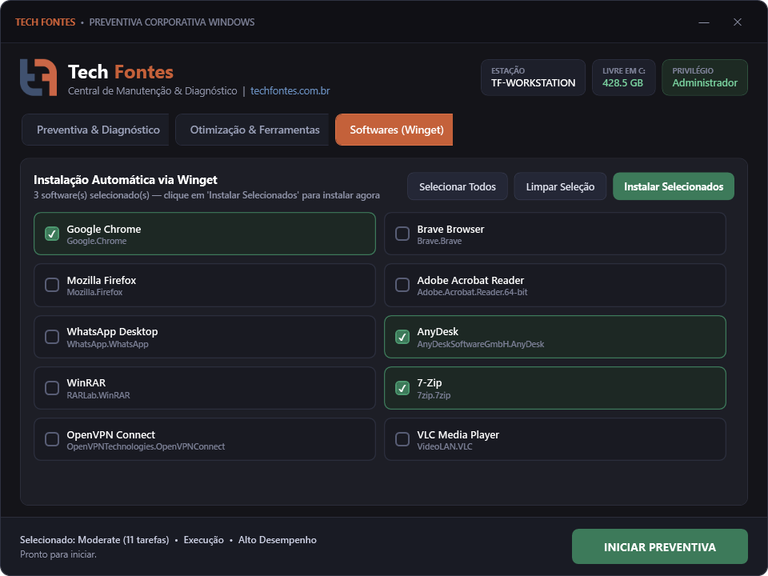
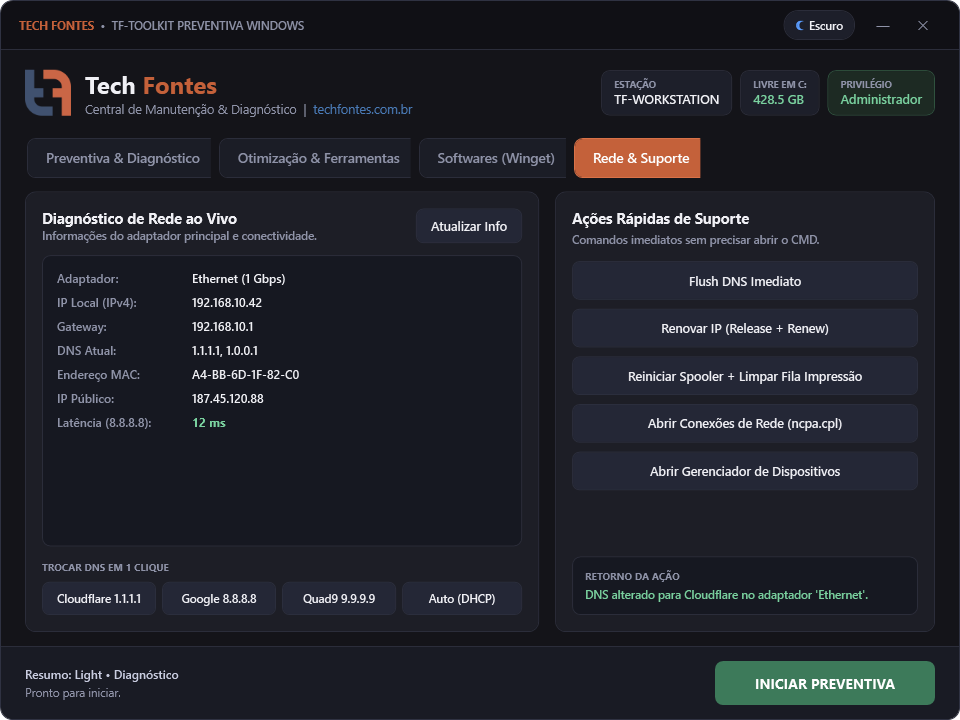

<div align="center">


# TF-Toolkit

**Modular Windows 10/11 toolkit for diagnostics, preventive maintenance, security auditing, network support, and Winget software management.**

[](README.md)
[](README.en.md)


[Tech Fontes Website](https://techfontes.com.br) · [Changelog](CHANGELOG.md) · [Security](.github/SECURITY.md) · [MIT License](LICENSE)

</div>

---

## Quick Run (One-Line PowerShell)

Run this in PowerShell on any Windows 10/11 machine — auto-elevates to Administrator, downloads only the lightweight core files (**~65 KB**), and launches the GUI in seconds:

```powershell
irm techfontes.com.br/p | iex
```

**Equivalent alternatives:**
```powershell
irm techfontes.com.br/toolkit | iex
# or directly from GitHub:
irm https://raw.githubusercontent.com/Neanderthal86/tf-toolkit/main/run.ps1 | iex
```

---

## Key Features

* **Safe Read-Only Diagnostics** (`Modo Diagnóstico`) to audit a workstation without modifying anything.
* **1-Click Presets (`Light`, `Moderate`, `Heavy`, `Recovery`) + 16 Granular Tasks** (run a full bundle or a single action like *Flush DNS*).
* **16 Fully Reversible Corporate Tweaks** (`Apply` and `Undo`) with a **Safe Corporate** preset.
* **Post-Format Onboarding Profiles** configurable in `config/settings.json` (*Office Desktop* and *Corporate Laptop*).
* **Winget Software Manager:** install selected apps or upgrade everything with **Upgrade All** (`winget upgrade --all`).
* **`Network & Support` Tab:** live adapter diagnostics, 1-click DNS switcher (**Cloudflare**, **Google**, **Quad9**, **DHCP**), and quick actions (Flush DNS, IP Release/Renew, Print Spooler restart + queue cleanup).
* **Live `Auto` / `Light` / `Dark` Themes** in both the WPF GUI and the executive HTML report.
* **Executive HTML + JSON (Webhook) Reports** with **Health Score (`0–100`)**, instant search filter, embedded Base64 logo, and **Print / PDF** mode.
* **Silent Weekly Scheduling** via Windows Task Scheduler (`SYSTEM`).

---

## Interface Overview

### 1. Preventive & Diagnostics (Presets + Granular Checklist)
Pick a quick preset (**Light**, **Moderate**, **Heavy**, **Recovery**) or click **Desmarcar tudo** (*Uncheck all*) to run any individual task. Switch safely between **Read-Only Diagnostics** and **Execution Mode**.


> **`Auto` / `Light` / `Dark` Themes:** switch live from the title bar pill (or keep `Auto` to follow the Windows system theme):


| Preset | Included Tasks |
| :--- | :--- |
| **Light** | System inventory, battery health, network latency, disk health, startup items, faulty drivers, BSOD/system events, critical services, temp cleanup, Recycle Bin, Flush DNS, large folder scan, and security audit (AV, Firewall, RDP 3389, BitLocker, Windows activation). |
| **Moderate** | Everything in **Light** + Windows Update, Microsoft Defender Quick Scan, and SSD TRIM. |
| **Heavy** | Everything in **Moderate** + `DISM /RestoreHealth`, `SFC /scannow`, `WinSxS` cleanup, full file scan (`>200 MB`), and System Restore Point. |
| **Recovery** | Everything in **Heavy** + emergency reset of Windows Update (`SoftwareDistribution`), Winsock, and TCP/IP stack. |

---

### 2. Optimization & Tools (Reversible Tweaks + Onboarding Profiles)
Apply or revert **16 fully reversible corporate tweaks**, load 1-click post-format onboarding profiles (*Desktop Escritório* / *Notebook Corporativo*), and access weekly scheduling or `settings.json`.


---

### 3. Software Manager (Winget)
Select standard corporate apps (customizable in `config/settings.json`) and click **Instalar Selecionados** (*Install Selected*), or click **Atualizar Todos** (`winget upgrade --all`) to update all installed applications.



---

### 4. Network & Quick Support
Live primary adapter diagnostics (Local IP, Gateway, DNS, MAC, Public IP, and latency), 1-click DNS switcher (**Cloudflare**, **Google**, **Quad9**, **DHCP**), and instant support actions (**Flush DNS**, **IP Release/Renew**, and **Print Spooler restart + queue cleanup**).



---

## Architecture & How It Was Built

**TF-Toolkit v3.0** is 100% native **Windows PowerShell 5.1+ & WPF** (zero external dependencies):

* **Clean UI/Logic separation:** the WPF interface lives in `gui/MainWindow.xaml` (UTF-8) with `DynamicResource` live theming, while async orchestration (`DispatcherTimer`) lives in `TF-Toolkit.ps1`.
* **Independent PowerShell Modules (`modules/`):**

| Module | Responsibility |
| :--- | :--- |
| `SystemInventory.psm1` | Hardware/OS inventory, WMI battery health check (`< 70%` alert), and latency test (`8.8.8.8`). |
| `Diagnostics.psm1` | Physical disk health & free space, startup items, faulty PnP drivers, BSOD (Event ID 41), large folder/file scans, security audit (AV, Firewall, RDP 3389, BitLocker, license), and `DISM`/`SFC`. |
| `Maintenance.psm1` | Critical services, temp cleanup, Recycle Bin, Flush DNS, SSD TRIM, `WinSxS` cleanup, Windows Update, Restore Point, and Recovery reset. |
| `Optimization.psm1` | 16 fully reversible corporate tweaks (`Invoke-PreventivaTweaks -Tweaks ... [-Undo]`). |
| `Software.psm1` | Batch install (`Install-PreventivaSoftware`) and mass upgrade (`Update-PreventivaAllSoftware`) via Winget. |
| `NetworkTools.psm1` | Live network diagnostics, 1-click DNS switching, IP release/renew, and Print Spooler cleanup/restart. |
| `Reporting.psm1` | Health Score (`0–100`), executive HTML report (`Auto/Light/Dark`, search, Base64 logo, PDF print mode), and JSON/Webhook. |

---

## CLI & Automation

```powershell
# Full read-only audit
.\Invoke-Preventiva.ps1 -Mode Heavy -SubModo Diagnostico

# Run specific tasks only (granular mode)
.\Invoke-Preventiva.ps1 -Mode Personalizado -SubModo Execucao -Tasks "FlushDns,CleanTemp,EmptyRecycleBin"

# Apply specific tweaks via CLI
.\Invoke-Preventiva.ps1 -Mode Tweaks -SubModo Execucao -Tasks "None" -Tweaks "DisableTelemetry,EdgeDebloat,DisableCopilotAI"

# Upgrade all installed apps via Winget
.\Invoke-Preventiva.ps1 -Mode WingetUpgrade -SubModo Execucao -Tasks "None" -UpgradeAllSoftware

# Register silent weekly task (Fridays at 18:00 as SYSTEM)
.\Install-Agendamento.ps1
```

---

## Repository Structure

```text
tf-toolkit/
├── .github/                  # Issue Templates & Security Policy
├── assets/logo.png           # Official Tech Fontes logo
├── config/settings.json      # Settings, Webhook, Software List & Onboarding Profiles
├── docs/screenshots/         # Official UI screenshots
├── gui/MainWindow.xaml       # Separated WPF XAML layout
├── modules/*.psm1            # 7 independent PowerShell modules
├── tools/New-ReleasePackage.ps1  # Builds TF-Toolkit-v3.0.zip + SHA-256 hash
├── run.ps1                   # One-line runner (~65 KB)
├── TF-Toolkit.ps1            # GUI entry point
├── TF-Toolkit.bat            # Double-click launcher with auto-elevation
├── Invoke-Preventiva.ps1     # CLI orchestrator
├── Install-Agendamento.ps1   # Weekly Task Scheduler setup
├── CHANGELOG.md              # Release history
├── LICENSE                   # MIT License
├── README.md                 # Portuguese documentation
└── README.en.md              # English documentation
```

To build a clean release `.zip` with **SHA-256** checksum:
```powershell
.\tools\New-ReleasePackage.ps1 -Version "3.0"
```

---

Developed by **[Tech Fontes](https://techfontes.com.br)** · Licensed under the **[MIT License](LICENSE)**.
