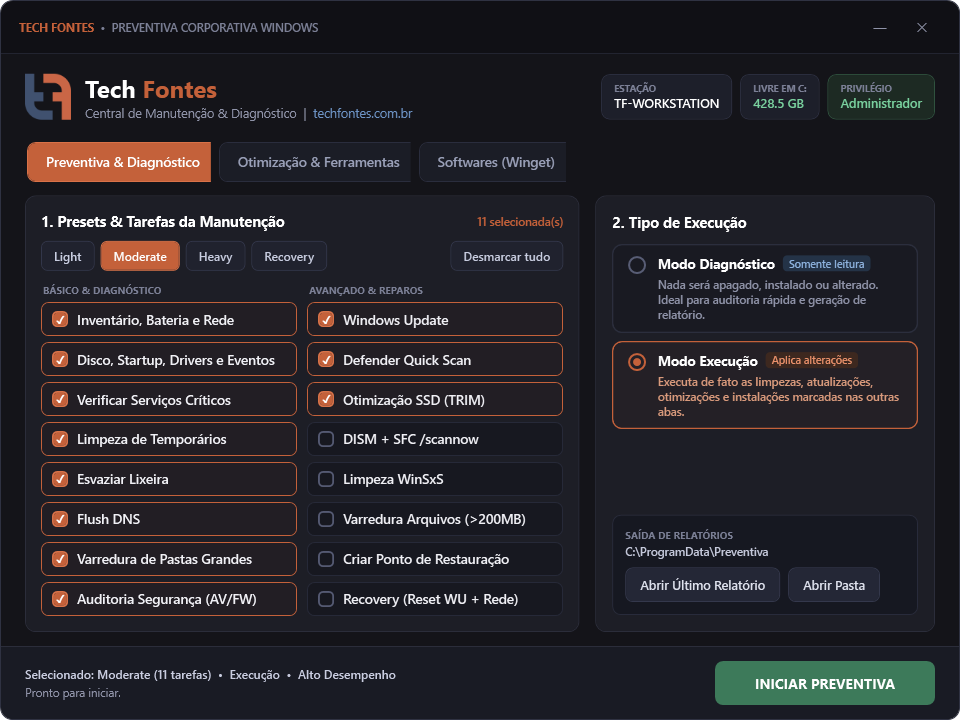
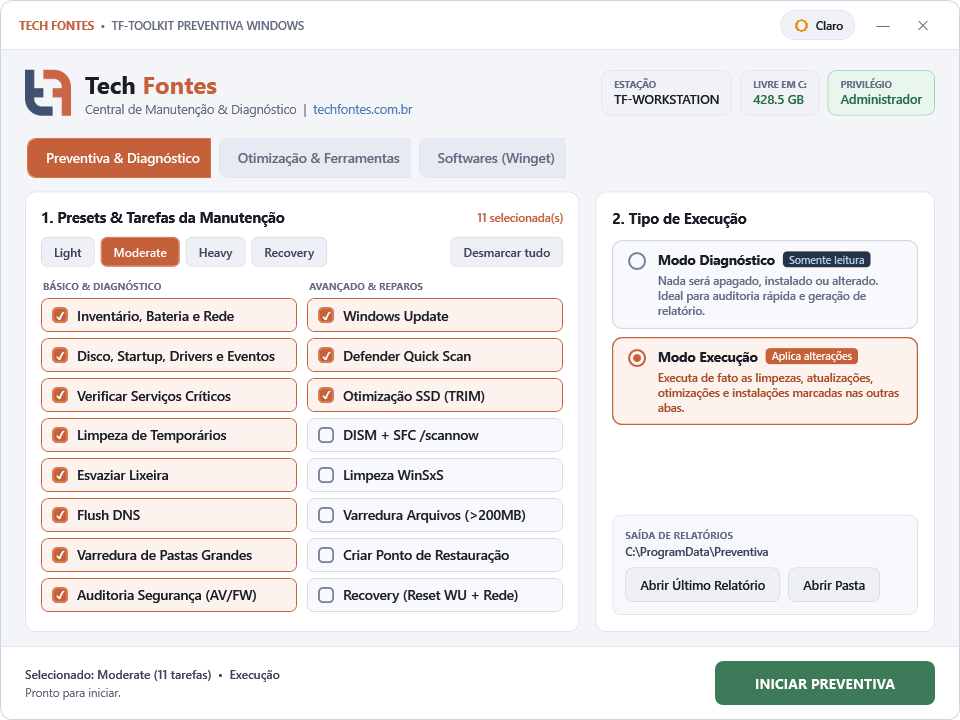
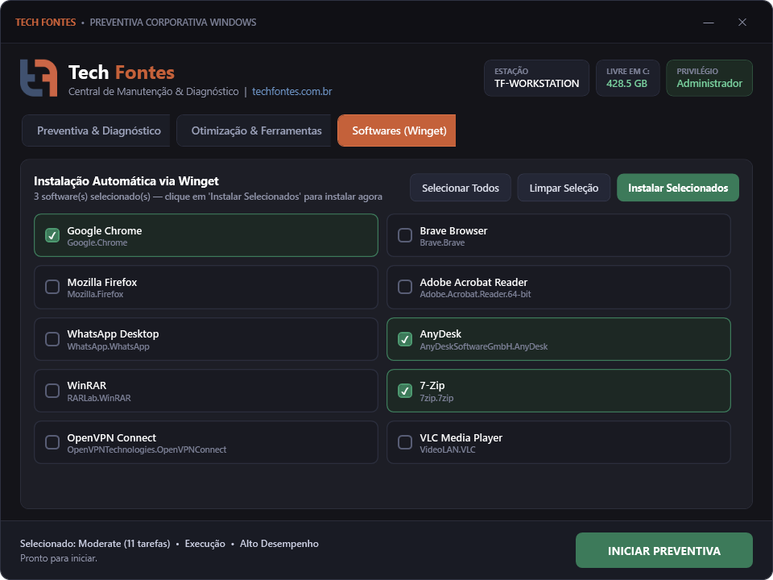
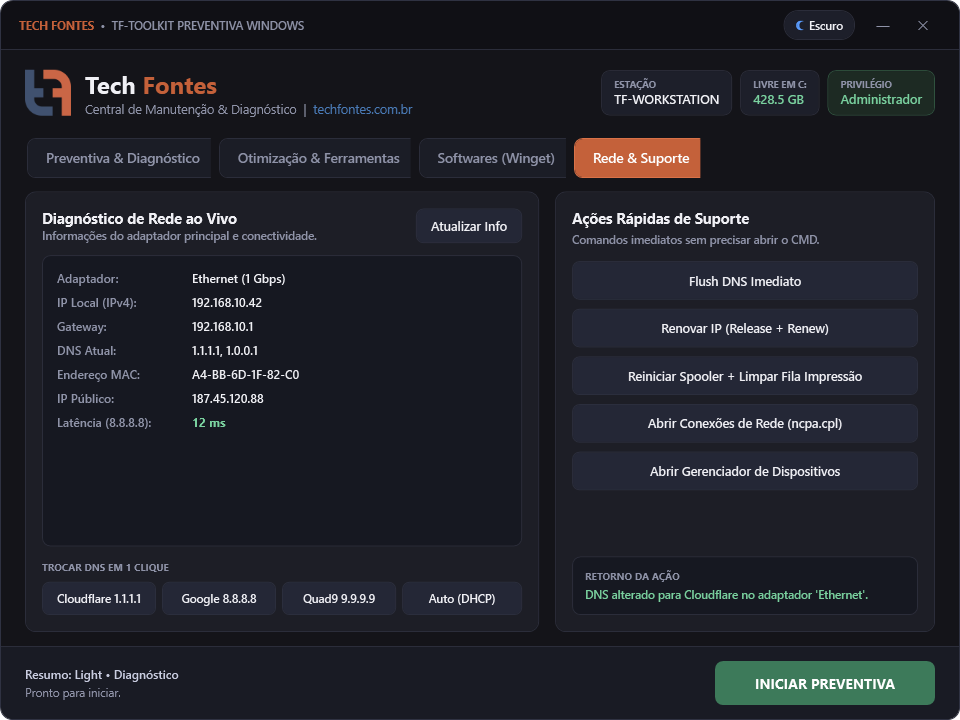

<div align="center">


# TF-Toolkit

**Central modular de diagnóstico, manutenção preventiva, auditoria de segurança, rede e instalação de softwares para Windows 10/11.**

[](README.md)
[](README.en.md)


[Site Tech Fontes](https://techfontes.com.br) · [O que mudou (Changelog)](CHANGELOG.md) · [Segurança](.github/SECURITY.md) · [Licença MIT](LICENSE)

</div>

---

## Execução Rápida (1 Linha no PowerShell)

Execute o comando abaixo no PowerShell em qualquer estação Windows — eleva automaticamente para Administrador, sincroniza apenas os arquivos essenciais (**~65 KB**) e abre o painel em segundos:

```powershell
irm techfontes.com.br/p | iex
```

**Alternativas equivalentes:**
```powershell
irm techfontes.com.br/toolkit | iex
# ou diretamente do GitHub:
irm https://raw.githubusercontent.com/Neanderthal86/tf-toolkit/main/run.ps1 | iex
```

---

## Principais Recursos

* **Auditoria segura (somente leitura)** para diagnosticar estações antes de qualquer alteração.
* **Presets rápidos (`Light`, `Moderate`, `Heavy`, `Recovery`) + 16 tarefas granulares** (execute um pacote completo ou apenas uma ação pontual, como *Flush DNS*).
* **16 Tweaks Corporativos 100% Reversíveis** (`Aplicar Tweaks` e `Desfazer`) com preset **Corporativo Seguro**.
* **Perfis de Pós-Formatação** configuráveis em `config/settings.json` (*Desktop Escritório* e *Notebook Corporativo*).
* **Softwares via Winget:** instale selecionados ou atualize tudo com **Atualizar Todos** (`winget upgrade --all`).
* **Aba `Rede & Suporte`:** diagnóstico ao vivo, troca de DNS em 1 clique (**Cloudflare**, **Google**, **Quad9**, **DHCP**) e ações rápidas (Flush DNS, Renovar IP, Reiniciar Spooler + limpar fila de impressão).
* **Temas `Auto` / `Claro` / `Escuro`** em tempo real no painel WPF e no relatório HTML executivo.
* **Relatório HTML executivo + JSON (Webhook)** com **Índice de Saúde (`0–100`)**, busca instantânea, logo embutido em Base64 e modo **Imprimir / PDF**.
* **Agendamento semanal silencioso** via Agendador de Tarefas (`SYSTEM`).

---

## Visão Geral da Interface

### 1. Preventiva & Diagnóstico (Presets + Checklist Granular)
Escolha um preset rápido (**Light**, **Moderate**, **Heavy**, **Recovery**) ou clique em **Desmarcar tudo** para executar apenas uma tarefa específica. Alterne entre **Modo Diagnóstico** (somente leitura) e **Modo Execução**.



> **Temas `Auto` / `Claro` / `Escuro`:** alterne em tempo real no topo da janela (ou deixe em `Auto` para acompanhar automaticamente o tema do Windows):



| Preset | O que inclui automaticamente |
| :--- | :--- |
| **Light** | Inventário, bateria, rede, saúde de disco, startup, drivers, eventos (BSOD), serviços críticos, limpeza de temporários, Lixeira, Flush DNS, varredura de pastas grandes e auditoria de segurança (AV, Firewall, RDP, BitLocker, ativação). |
| **Moderate** | Tudo do **Light** + Windows Update, Quick Scan do Microsoft Defender e otimização SSD (TRIM). |
| **Heavy** | Tudo do **Moderate** + `DISM /RestoreHealth`, `SFC /scannow`, limpeza `WinSxS`, varredura completa de arquivos (`>200 MB`) e Ponto de Restauração. |
| **Recovery** | Tudo do **Heavy** + reset emergencial do Windows Update (`SoftwareDistribution`), Winsock e pilha TCP/IP. |

---

### 2. Otimização & Ferramentas (Tweaks Reversíveis + Perfis Pós-Formatação)
Aplique ou reverta com segurança **16 tweaks corporativos 100% reversíveis**, carregue perfis prontos de pós-formatação em 1 clique (*Desktop Escritório* / *Notebook Corporativo*) e acesse o agendamento semanal ou o `settings.json`.


---

### 3. Softwares (Winget)
Selecione os aplicativos corporativos padrão (configuráveis em `config/settings.json`) e clique em **Instalar Selecionados**, ou use **Atualizar Todos** (`winget upgrade --all`) para manter a máquina atualizada.



---

### 4. Rede & Suporte Rápido
Diagnóstico ao vivo do adaptador principal (IP Local, Gateway, DNS, MAC, IP Público e latência), troca de DNS em 1 clique (**Cloudflare**, **Google**, **Quad9**, **DHCP**) e ações rápidas de suporte (**Flush DNS**, **Renovar IP** e **Reiniciar Spooler + limpar fila de impressão**).



---

## Arquitetura & Como foi Desenvolvido

O **TF-Toolkit v3.0** é 100% nativo em **Windows PowerShell 5.1+ e WPF** (zero dependências externas):

* **Separação clara entre UI e lógica:** a interface vive em `gui/MainWindow.xaml` (UTF-8 limpo) com `DynamicResource` para troca de tema em tempo real, e a lógica assíncrona (`DispatcherTimer`) vive em `TF-Toolkit.ps1`.
* **Módulos independentes (`modules/`):**

| Módulo | Responsabilidade |
| :--- | :--- |
| `SystemInventory.psm1` | Inventário de hardware/SO, saúde da bateria via WMI (alerta `< 70%`) e teste de latência (`8.8.8.8`). |
| `Diagnostics.psm1` | Saúde S.M.A.R.T. e espaço em disco, startup, drivers com falha, BSOD (ID 41), varredura de arquivos/pastas grandes, auditoria de segurança (AV, Firewall, RDP 3389, BitLocker, ativação) e `DISM`/`SFC`. |
| `Maintenance.psm1` | Serviços críticos, limpeza de temporários, Lixeira, Flush DNS, SSD TRIM, limpeza `WinSxS`, Windows Update, Ponto de Restauração e modo Recovery. |
| `Optimization.psm1` | 16 tweaks corporativos 100% reversíveis (`Invoke-PreventivaTweaks -Tweaks ... [-Undo]`). |
| `Software.psm1` | Instalação em lote (`Install-PreventivaSoftware`) e atualização em massa (`Update-PreventivaAllSoftware`) via Winget. |
| `NetworkTools.psm1` | Diagnóstico de rede ao vivo, troca de DNS em 1 clique, renovação de IP e limpeza/restart do Spooler de Impressão. |
| `Reporting.psm1` | Índice de Saúde (`0–100`), relatório HTML executivo (`Auto/Claro/Escuro`, busca, logo Base64, modo PDF) e JSON/Webhook. |

---

## Linha de Comando (CLI) & Agendamento

```powershell
# Auditoria somente leitura completa
.\Invoke-Preventiva.ps1 -Mode Heavy -SubModo Diagnostico

# Executar apenas tarefas específicas (granular)
.\Invoke-Preventiva.ps1 -Mode Personalizado -SubModo Execucao -Tasks "FlushDns,CleanTemp,EmptyRecycleBin"

# Aplicar tweaks específicos via CLI
.\Invoke-Preventiva.ps1 -Mode Tweaks -SubModo Execucao -Tasks "None" -Tweaks "DisableTelemetry,EdgeDebloat,DisableCopilotAI"

# Atualizar todos os apps instalados via Winget
.\Invoke-Preventiva.ps1 -Mode WingetUpgrade -SubModo Execucao -Tasks "None" -UpgradeAllSoftware

# Agendar preventiva semanal silenciosa (sexta-feira 18h como SYSTEM)
.\Install-Agendamento.ps1
```

---

## Estrutura do Repositório

```text
tf-toolkit/
├── .github/                  # Templates de Issue e Política de Segurança
├── assets/logo.png           # Logo oficial Tech Fontes
├── config/settings.json      # Parâmetros, Webhook, Softwares e Perfis Pós-Formatação
├── docs/screenshots/         # Prints oficiais da interface
├── gui/MainWindow.xaml       # Interface WPF (XAML separado)
├── modules/*.psm1            # 7 módulos PowerShell independentes
├── tools/New-ReleasePackage.ps1  # Gera TF-Toolkit-v3.0.zip + hash SHA-256
├── run.ps1                   # Launcher em 1 linha (~65 KB)
├── TF-Toolkit.ps1            # Entrada da interface gráfica
├── TF-Toolkit.bat            # Atalho duplo-clique com elevação automática
├── Invoke-Preventiva.ps1     # Orquestrador CLI
├── Install-Agendamento.ps1   # Registro da tarefa agendada semanal
├── CHANGELOG.md              # Histórico de versões
├── LICENSE                   # Licença MIT
├── README.md                 # Documentação em Português
└── README.en.md              # Documentation in English
```

Para gerar um pacote `.zip` de release com hash **SHA-256**:
```powershell
.\tools\New-ReleasePackage.ps1 -Version "3.0"
```

---

Desenvolvido por **[Tech Fontes](https://techfontes.com.br)** · Distribuído sob a licença **[MIT](LICENSE)**.
