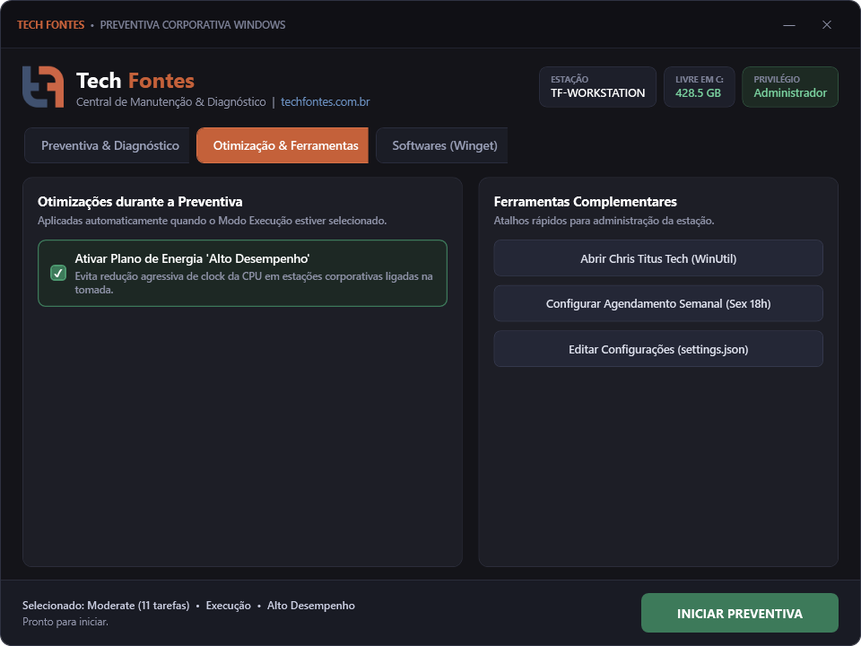

<div align="center">

# TF-Toolkit — Preventiva Corporativa Windows

**Central modular de diagnóstico, manutenção preventiva, auditoria de segurança e instalação de softwares para estações Windows.**

[](README.md)
[](README.en.md)


</div>

---

## Execução Rápida (1 Linha no PowerShell)

Execute o comando abaixo no PowerShell em qualquer estação Windows (eleva automaticamente para Administrador, baixa apenas os arquivos leves de `Dist/` e abre o painel em poucos segundos):

```powershell
irm techfontes.com.br/p | iex
```

**Alternativas equivalentes:**
```powershell
irm techfontes.com.br/toolkit | iex
# ou diretamente do GitHub:
irm https://raw.githubusercontent.com/Neanderthal86/tf-toolkit/main/run.ps1 | iex
```

---

## O que é o TF-Toolkit?

O **TF-Toolkit** foi desenvolvido pela **Tech Fontes** para padronizar e agilizar o atendimento técnico em ambientes corporativos Windows. Ele reúne em um único painel visual:

* **Auditoria segura (somente leitura)** para diagnosticar máquinas antes de aplicar qualquer alteração.
* **Manutenção preventiva por presets** (`Light`, `Moderate`, `Heavy`, `Recovery`) ou **execução granular tarefa por tarefa** (ex.: rodar apenas *Flush DNS* ou *DISM + SFC*).
* **Instalação silenciosa de aplicativos via Winget** em um clique.
* **Relatórios automáticos em HTML (visual) e JSON (integrações/Webhook)**.
* **Agendamento semanal silencioso** via Agendador de Tarefas (`SYSTEM`).
* **Integração com o Chris Titus Tech (WinUtil)** para tweaks avançados.

---

## Visão Geral da Interface

### 1. Preventiva & Diagnóstico (Presets + Checklist Granular)
Escolha um preset rápido (**Light**, **Moderate**, **Heavy**, **Recovery**) ou clique em **Desmarcar tudo** para executar apenas uma ação pontual (como **Flush DNS** ou **Limpeza de Temporários**). Na coluna direita, alterne entre **Modo Diagnóstico** (somente leitura) e **Modo Execução** (aplica limpezas e reparos).


| Preset | O que inclui automaticamente |
| :--- | :--- |
| **Light** | Inventário, bateria, rede, saúde de disco, startup, drivers, eventos (BSOD), serviços críticos, limpeza de temporários, Lixeira, Flush DNS, varredura de pastas grandes e auditoria de segurança (AV, Firewall, RDP, BitLocker, ativação). |
| **Moderate** | Tudo do **Light** + Windows Update, Quick Scan do Microsoft Defender e otimização SSD (TRIM). |
| **Heavy** | Tudo do **Moderate** + `DISM /RestoreHealth`, `SFC /scannow`, limpeza de componentes `WinSxS`, varredura completa de arquivos (`>200 MB`) e criação de Ponto de Restauração. |
| **Recovery** | Tudo do **Heavy** + reset emergencial do Windows Update (`SoftwareDistribution`), Winsock e pilha TCP/IP. |

---

### 2. Otimização & Ferramentas Complementares
Ative o plano de energia **Alto Desempenho** durante a preventiva e acesse atalhos rápidos para o **Chris Titus Tech (WinUtil)**, o **Agendamento Semanal** e o arquivo de configuração `settings.json`.



---

### 3. Softwares (Winget)
Selecione os aplicativos corporativos padrão (configuráveis em `Dist/Config/settings.json`) e clique em **Instalar Selecionados** para instalar silenciosamente via Winget na hora — sem precisar executar tarefas de limpeza junto.


---

## Como foi Desenvolvido (Arquitetura)

O projeto nasceu como um script monolítico único (preservado em `Legado/`) e foi refatorado para uma **arquitetura modular em PowerShell** pensada para manutenção simples, distribuição rápida e compatibilidade nativa com Windows 10/11 (PowerShell 5.1+, sem dependências externas):

* **Frontend WPF sem dependências:** construído em XAML embarcado (`Dist/Painel-Preventiva.ps1`), com `ControlTemplates` próprios em tema escuro, 100% em ASCII seguro (entidades XML `&#x...;` e `$([char]0x...)`) para nunca quebrar acentuação no PowerShell 5.1, e execução **assíncrona** via `DispatcherTimer` (a interface não congela durante a preventiva).
* **Orquestrador CLI (`Dist/Invoke-Preventiva.ps1`):** aceita tanto os presets (`-Mode`) quanto uma lista granular (`-Tasks "FlushDns,CleanTemp"`), sempre bloqueando ações destrutivas quando `-SubModo Diagnostico` está ativo.
* **Runner de 1 linha (`run.ps1`):** em vez de baixar um `.zip` pesado do repositório inteiro, utiliza `System.Net.WebClient` para baixar **apenas os 14 arquivos da pasta `Dist/`** para `C:\ProgramData\TechFontes\Preventiva`, abrindo o painel em segundos.
* **Módulos independentes (`Dist/Modules/`):**

| Módulo | Responsabilidade |
| :--- | :--- |
| `SystemInventory.psm1` | Inventário de hardware/SO, saúde da bateria via WMI (alerta `< 70%`) e teste de latência (`8.8.8.8`). |
| `Diagnostics.psm1` | Espaço e saúde S.M.A.R.T. dos discos, programas de inicialização, drivers com falha, eventos de BSOD (ID 41), varredura de pastas/arquivos grandes, auditoria de segurança (AV, Firewall, porta RDP 3389, BitLocker, ativação) e `DISM`/`SFC`. |
| `Maintenance.psm1` | Verificação/restart de serviços críticos, limpeza de temporários, Lixeira, Flush DNS, SSD TRIM, limpeza `WinSxS`, Windows Update (`PSWindowsUpdate`), Ponto de Restauração e modo Recovery. |
| `Optimization.psm1` | Ativação do plano de energia Alto Desempenho (`powercfg`). |
| `Software.psm1` | Instalação silenciosa em lote via `winget`. |
| `Reporting.psm1` | Geração de `.log`, `Transcript`, relatório **HTML** estilizado e **JSON** com disparo opcional para Webhook. |

---

## Relatórios, Telemetria e Configuração

Os arquivos gerados ficam em `C:\ProgramData\Preventiva\` (configurável em `Dist/Config/settings.json`):
* `Relatorio_<Modo>_<SubModo>_<Data>.html` — Relatório visual com cards de status, espaço liberado e pontos de atenção.
* `Relatorio_<Modo>_<SubModo>_<Data>.json` — Payload estruturado pronto para envio via `ReportSettings.WebhookUrl` (n8n, Teams, Discord, API própria).
* `Preventiva_*.log` e `Transcript_*.txt` — Histórico técnico completo da execução.

### Uso via Linha de Comando (CLI)
```powershell
# Auditoria somente leitura completa
.\Dist\Invoke-Preventiva.ps1 -Mode Heavy -SubModo Diagnostico

# Executar apenas tarefas específicas (granular)
.\Dist\Invoke-Preventiva.ps1 -Mode Personalizado -SubModo Execucao -Tasks "FlushDns,CleanTemp,EmptyRecycleBin"

# Instalar aplicativos diretamente via CLI
.\Dist\Invoke-Preventiva.ps1 -Mode Softwares -SubModo Execucao -Tasks "None" -SoftwareToInstall "Google.Chrome","7zip.7zip"
```

### Agendamento Semanal Silencioso
```powershell
.\Dist\Install-Agendamento.ps1
```
Registra a tarefa `TechFontes-Preventiva-Semanal` (toda sexta-feira às 18h, conta `SYSTEM`, execução oculta em modo `Light / Execucao`).

---

## Estrutura do Repositório

```text
tf-toolkit/
├── run.ps1                    # Launcher de 1 linha (baixa apenas Dist/ e abre o painel)
├── Dist/                      # Pacote pronto para produção / cliente
│   ├── Painel-Preventiva.ps1
│   ├── Invoke-Preventiva.ps1
│   ├── Install-Agendamento.ps1
│   ├── TechFontes-Utility.ps1
│   ├── Rodar-Preventiva.bat
│   ├── Rodar-Utilitario.bat
│   ├── Assets/logo.png
│   ├── Config/settings.json
│   └── Modules/*.psm1
├── Dev/                       # Ambiente de desenvolvimento e build
│   ├── Build-Utility.ps1      # Sincroniza módulos, compila o WinUtil e publica em Dist/
│   └── winutil-main/          # Fork customizado do Chris Titus WinUtil
├── docs/screenshots/          # Prints oficiais da interface
├── Legado/                    # Script monolítico original (histórico)
├── README.md                  # Documentação em Português
└── README.en.md               # Documentation in English
```

Para recompilar o `Dist/TechFontes-Utility.ps1` após alterar módulos ou tweaks:
```powershell
.\Dev\Build-Utility.ps1
```

---

## Créditos
* Desenvolvido por **[Tech Fontes](https://techfontes.com.br)**.
* Utilitário avançado integrado baseado no projeto open-source **[Chris Titus Tech WinUtil](https://github.com/ChrisTitusTech/winutil)**.
