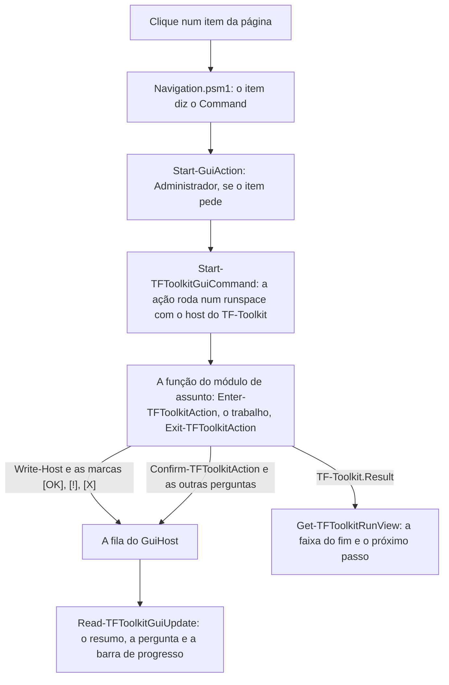
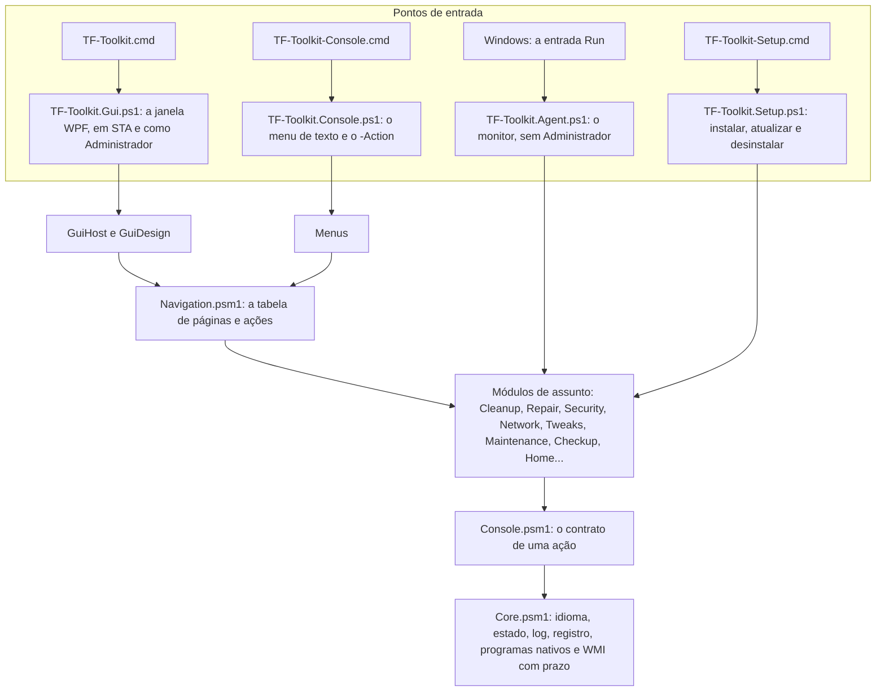
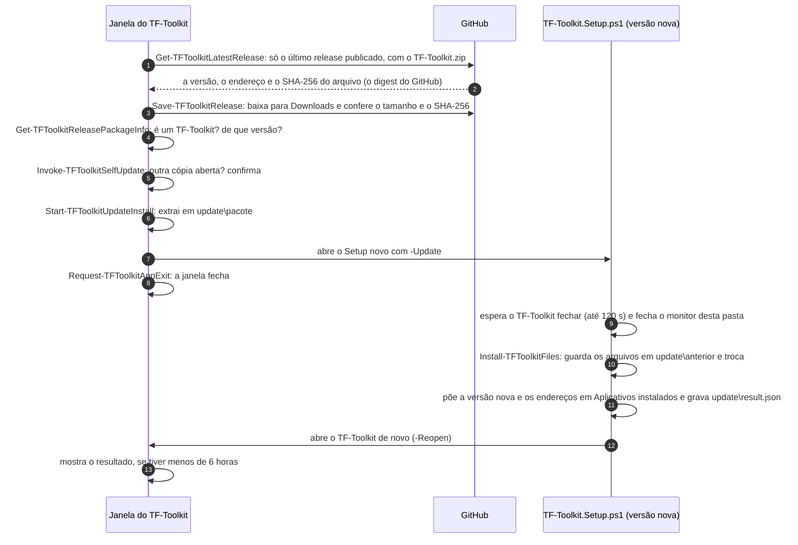

# TF-Toolkit 4.0 — documentação técnica

**Atualizada em:** 22/11/2026 · **Vale para:** a Build 4.0

**Para quem é:** quem vai manter, revisar ou estender o TF-Toolkit. A [parte de produto](#produto) diz o que ele é, para quem e por que se comporta como se comporta. A [parte de desenvolvimento](#desenvolvimento) diz como ele é feito, onde fica cada coisa e o que não pode quebrar ao mudar o código. Quem chega agora começa por [Comece por aqui](#5-comece-por-aqui).

**De onde vêm os dados:** tudo aqui foi conferido no código. Os números (páginas, itens, ajustes, funções, textos) foram contados nele e mudam a cada versão. Quando o código e este documento discordarem, vale o código; este documento diz onde olhar.

**Os outros documentos:** o [índice da pasta docs](README.md) diz o que cada um tem. Para quem só usa o TF-Toolkit, o [README](../README.md).

## Sumário

**Produto**
1. [O que é o TF-Toolkit](#1-o-que-é-o-tf-toolkit)
2. [Princípios do produto](#2-princípios-do-produto)
3. [As telas e o que cada uma faz](#3-as-telas-e-o-que-cada-uma-faz)
4. [Os fluxos principais](#4-os-fluxos-principais)

**Desenvolvimento**

5. [Comece por aqui](#5-comece-por-aqui)
6. [Requisitos e o repositório](#6-requisitos-e-o-repositório)
7. [Arquitetura](#7-arquitetura)
8. [A tabela de navegação](#8-a-tabela-de-navegação)
9. [O contrato de uma ação](#9-o-contrato-de-uma-ação)
10. [A janela](#10-a-janela)
11. [O menu de texto e a linha de comando](#11-o-menu-de-texto-e-a-linha-de-comando)
12. [O monitor na bandeja, a manutenção agendada e rodar sem Administrador](#12-o-monitor-na-bandeja-a-manutenção-agendada-e-rodar-sem-administrador)
13. [Instalar, atualizar e desinstalar](#13-instalar-atualizar-e-desinstalar)
14. [Ajustes do Windows](#14-ajustes-do-windows)
15. [Histórico de mudanças e desfazer](#15-histórico-de-mudanças-e-desfazer)
16. [Dados, estado e integração com o Windows](#16-dados-estado-e-integração-com-o-windows)
17. [O que vai para a internet](#17-o-que-vai-para-a-internet)
18. [Idiomas](#18-idiomas)
19. [O visual da janela](#19-o-visual-da-janela)
20. [Regras de engenharia](#20-regras-de-engenharia)
21. [Como estender](#21-como-estender)
22. [Montar e publicar uma versão](#22-montar-e-publicar-uma-versão)
23. [Riscos e limitações conhecidas](#23-riscos-e-limitações-conhecidas)
24. [Glossário](#24-glossário)
25. [Documentos relacionados](#25-documentos-relacionados)

---

# Produto

## 1. O que é o TF-Toolkit

O TF-Toolkit cuida de um PC com Windows num lugar só: limpa, repara, atualiza, mostra o que está errado e avisa antes de o problema aparecer. É feito em PowerShell, de código aberto (GNU GPLv3), e roda no Windows PowerShell 5.1 que já vem no Windows 10 e no 11, sem instalar mais nada.

**Para quem:**
- **quem usa o PC e não é técnico:** abre o TF-Toolkit, vê a nota de saúde no Início e clica em Otimizar ou em Verificar o PC. As perguntas vêm em palavras simples, e o resultado diz o que mudou e o que ainda pede atenção;
- **quem cuida dos PCs da família ou de um escritório pequeno:** usa as ferramentas uma a uma (Limpeza, Reparo, Rede, Ajustes do Windows), o histórico de mudanças para voltar atrás, o relatório e o pacote de suporte;
- **quem automatiza:** usa a linha de comando (`-Action Check -Json`, `-Action Report`) em tarefas e scripts.

**Como ele chega à pessoa:**

| Superfície | O que é | Quem abre |
|---|---|---|
| Janela | A interface principal (WPF), com barra lateral, cartões e as ações rodando dentro dela | `TF-Toolkit.cmd` ou o atalho do Menu Iniciar |
| Menu de texto | As mesmas páginas e ações num terminal | `TF-Toolkit-Console.cmd` |
| Monitor na bandeja | Um ícone perto do relógio que só lê e avisa | O Windows, ao entrar na conta (opcional) |
| Manutenção agendada | Uma limpeza leve e um relatório por mês | O Agendador de Tarefas (opcional) |
| Linha de comando | Verificação rápida, relatório e atalho, sem menu | Scripts e tarefas |
| Instalador | Instala, atualiza e desinstala | `TF-Toolkit-Setup.cmd` e Configurações > Aplicativos |

**Idiomas:** português, inglês e espanhol, seguindo o idioma do Windows ou a escolha em Sobre o TF-Toolkit > Idioma.

## 2. Princípios do produto

São as regras que explicam as decisões do código. Ao propor uma mudança, confira se ela respeita cada uma.

1. **Perguntar antes do que tem peso.** As ações que apagam, desinstalam ou mexem fundo no sistema perguntam antes, e o que apaga sem volta vem com o botão vermelho. O que é leve e seguro (Acelerar agora, atualizar as assinaturas do antivírus) roda num clique; numa chave de ajuste, o próprio clique é a confirmação. O que só lê não pede confirmação.
2. **Sozinho, só o que é seguro.** O que roda sem ninguém olhando (a manutenção agendada, o monitor) só lê ou apaga temporários com mais de 7 dias. Não esvazia a Lixeira, não repara, não atualiza e não mexe em ajustes.
3. **Dá para voltar atrás.** Cada ajuste guarda o valor original antes de mudar. As mudanças no PC entram no histórico de mudanças, com o desfazer quando existe. O Otimizar começa por um ponto de restauração.
4. **Dizer o que aconteceu, com palavras.** Cada ação termina com uma faixa que diz o resultado ("PC otimizado", "3 ameaças pedem ação"), o motivo do que falhou e, quando existe, um botão para o próximo passo. O erro do Windows chega à pessoa sem o embrulho técnico do PowerShell (`ConvertTo-TFToolkitReadableError`).
5. **Não prometer o que não pode cumprir.** A nota de saúde é "uma leitura rápida do que o TF-Toolkit consegue ver", não um laudo: com uma leitura faltando ela não fica verde. O registro não entra no Otimizar, porque a Microsoft não dá suporte a limpadores de registro.
6. **Respeitar as escolhas da pessoa.** O que a pessoa ligou no Windows (as atualizações antecipadas, por exemplo) não é desligado a cada Otimizar. A aparência (a barra de tarefas, a área de trabalho, as cores) é gosto: a revisão do Otimizar não a oferece, e nenhum ajuste dela é recomendado. As listas de remover programas e aplicativos não têm "marcar todos".
7. **Os dados ficam no PC.** O TF-Toolkit não tem conta, nem telemetria, nem envio de dados do PC. O que ele baixa e consulta na internet está na [seção 17](#17-o-que-vai-para-a-internet). Segredos (a senha do Wi-Fi, a chave do BitLocker) aparecem na tela, mas nunca vão para o log.
8. **As duas interfaces são uma só.** A janela e o menu de texto leem a mesma tabela de navegação e rodam as mesmas funções. Nenhuma ação existe só numa delas.
9. **Sem dependências.** Só o que vem no Windows: Windows PowerShell 5.1, .NET Framework, WPF, WMI e as ferramentas do sistema (DISM, SFC, CHKDSK, winget quando existe).

## 3. As telas e o que cada uma faz

A janela tem o **Início** (a nota de saúde e os cartões do estado do PC) e 12 páginas: 11 na barra lateral, em quatro grupos, e o Sobre o TF-Toolkit no rodapé. São 107 itens ao todo, entre ações do TF-Toolkit e atalhos para janelas do Windows (e um para o site do TF-Toolkit).

| Grupo | Página (Id) | Itens | Atalhos do Windows | Pedem Administrador |
|---|---|---|---|---|
| Cuidar | Manutenção (`maintenance`) | 8 | 2 | 4 |
| Cuidar | Limpeza (`cleanup`) | 12 | 1 | 4 |
| Cuidar | Desempenho (`performance`) | 5 | 1 | 0 |
| Consertar | Reparo (`repair`) | 9 | 2 | 7 |
| Consertar | Diagnóstico (`diagnostics`) | 14 | 2 | 2 |
| Consertar | Rede (`network`) | 9 | 0 | 6 |
| Proteger | Segurança (`security`) | 8 | 1 | 5 |
| Proteger | Atualizações (`updates`) | 9 | 2 | 3 |
| Configurar | Programas (`software`) | 13 | 3 | 3 |
| Configurar | Ajustes do Windows (`tweaks`) | 8 | 1 | 4 |
| Configurar | Personalização (`personalize`) | 3 | 3 | 0 |
| Rodapé | Sobre o TF-Toolkit (`app`) | 9 | 2 | 0 |
| | **Total** | **107** | **20** | **38** |

Quatro itens não viram cartão (`Unlisted`): o Histórico de manutenções (aberto pela faixa "Última manutenção", no alto da página) e o Agendador de Tarefas, na Manutenção, o Reparar o Instalador de Aplicativo, em Programas (o botão da faixa "Falta o Instalador de Aplicativo" e a faixa do alto da página, quando ele falta, levam a ele), e o Idioma, no Sobre o TF-Toolkit. A busca e o menu de texto chegam neles. Onze itens são o destaque da página (`Accent`).

No alto de nove páginas, uma faixa de resumo (`New-GuiPageStatus`) mostra o estado do assunto da página, de leituras rápidas. Uma linha com destino (`Opens`) é um botão com a seta, como as linhas das listas; sem destino, ela só informa.

| Página | Leitura | As linhas que levam a algum lugar |
|---|---|---|
| Manutenção | `Get-TFToolkitMaintenancePageStatus` | Última manutenção: o Histórico de manutenções |
| Limpeza | `Get-TFToolkitCleanupPageStatus` | O disco do sistema, só com pouco espaço: a Limpeza personalizada, o mesmo destino do "Liberar espaço" do Início, do Verificar o PC e do aviso do monitor |
| Desempenho | `Get-TFToolkitPerformancePageStatus` | Só quando pedem atenção: a memória a partir de 85%, Programas pesando agora (o destino do Verificar o PC); o PC ligado há 7 dias ou mais, Tempo ligado e energia (que explica por que desligar, com a Inicialização Rápida, não zera esse tempo) |
| Rede | `Get-TFToolkitNetworkPageStatus` | A conexão sem internet, com o acesso limitado ou sem rede: o Testar conectividade |
| Atualizações | `Get-TFToolkitUpdatesPageStatus` | Só quando pedem atenção: o suporte acabando ou acabado, Suporte do Windows; as atualizações pausadas (`Get-TFToolkitWindowsUpdatePause`), o Windows Update das Configurações; atrasadas, Instalar atualizações do Windows (a mesma conta do Início) |
| Programas | `Get-TFToolkitSoftwarePageStatus` | Só aparece quando falta o Instalador de Aplicativo (o winget): o reparo |
| Ajustes do Windows e Personalização | `Get-TFToolkitTweaksPageStatus`, feito da lista que a página acabou de ler e refeito quando uma chave muda (`Set-GuiTweaksStatus`) | Recomendados (só em Ajustes do Windows): Aplicar ajustes recomendados, enquanto falta algum; Mudanças (os ajustes da página que o TF-Toolkit mudou e continuam como ele deixou): o Histórico de mudanças. Elevado com outra conta, só a linha Outra conta, em amarelo |
| Sobre o TF-Toolkit | `Get-TFToolkitAboutPageStatus` | A versão, com uma versão nova conhecida (`Get-TFToolkitKnownUpdate`): Verificar nova versão. As linhas do Administrador e do atalho só aparecem quando dizem algo que a barra lateral não diz (sem o Administrador) ou que vale para a pessoa (com outra conta, o atalho seria o dessa conta, e fica de fora) |

As duas páginas de ajustes (Ajustes do Windows e Personalização) são diferentes das outras: além dos itens, elas mostram a lista de chaves liga/desliga dos 53 ajustes ([seção 14](#14-ajustes-do-windows)).

O mapa item por item, com a frase de cada um, está em [funcionalidades-4.0.md](funcionalidades-4.0.md).

## 4. Os fluxos principais

### 4.1 Início

O Início é a primeira tela. Ele não muda nada no PC: os cartões só mostram e levam à tela do assunto. Quem muda o PC são os botões da nota (Otimizar e Verificar o PC) e os de cada ponto de atenção.

- **A tela, de cima para baixo:** a nota de saúde (a frase, os botões e a nota de 0 a 100 com dez traços); "Seu PC", com três cartões (Disco do sistema, com a barra de uso; Proteção; Sistema) e uma linha com Última manutenção, Reinício pendente e Bateria (a bateria some num PC de mesa); "Histórico neste PC"; e a faixa "Configuração inicial", enquanto faltar um dos três passos. Cada cartão e cada parte da linha leva a um item da navegação (`$script:TFToolkitHomeFactTargets`, em `Home.psm1`).
- **A leitura em etapas:** são 7 etapas (sessão, disco, reinício, manutenção, manutenção agendada, bateria e proteção), lidas uma por vez num runspace à parte. Cada cartão aparece quando a etapa dele termina, e uma etapa que falha vira "Não foi possível ler" sem apagar as outras. A proteção vem por último porque é a mais demorada.
- **A nota de saúde** (`Get-TFToolkitHealthScore`): 100 menos o peso de cada ponto de atenção. Os pontos vêm das leituras: espaço no disco, reinício pendente, manutenção, antivírus, firewall e ameaças, as correções de segurança do Windows e a manutenção agendada (quando ela existe e não está rodando). Um ponto grave (peso 20 ou mais: nenhum antivírus ativo, proteção em tempo real desligada, disco quase cheio, Windows sem as correções do mês) limita a nota a 74. Se uma leitura que entra na nota falha, a nota vale para o resto e a tela avisa.

| Nota | Rótulo | Cor |
|---|---|---|
| 90 ou mais | Ótima | verde |
| 75 a 89 | Boa | verde |
| 50 a 74 | Pede atenção | amarelo |
| abaixo de 50 | Crítica | vermelho |
| verde, mas com uma leitura faltando | Incompleta | amarelo |

- **Os botões** saem de `Get-TFToolkitHealthActionPlan` (`GuiDesign.psm1`): os dois da nota (Verificar o PC e Otimizar) e um por ponto de atenção, sem repetir o que um botão da nota já resolve. O destaque é um só: sem pontos de atenção, o Otimizar; com eles, o botão que resolve o mais pesado.

### 4.2 Verificar o PC

`Invoke-TFToolkitCheckup` (`Checkup.psm1`). Uma passada que só lê, em 11 etapas: espaço e saúde dos discos, temporários, registro, atalhos, memória, o que abre com o Windows, programas desatualizados (winget), suporte e atualizações do Windows, proteção, reinício pendente e telas azuis.

A consulta do winget é a mais demorada (depende da rede): `Start-TFToolkitWingetUpgradeRead` (Software.psm1, a mesma do Otimizar) a começa em segundo plano antes da primeira etapa (`Start-TFToolkitInBackground`), e `Get-TFToolkitCheckupPrograms -Read` só recebe a resposta (`Receive-TFToolkitWingetUpgradeRead`), com prazo de 120 segundos contados do começo (`TFToolkitWingetReadTimeoutSec`). Sem resposta, a etapa fica como não lida e a verificação termina; o `finally` da varredura larga a consulta numa parada. A regra da resposta é `ConvertTo-TFToolkitCheckupProgramsFinding`, a mesma da tela Atualizar programas. Sem o winget, o ponto leva ao reparo do Instalador de Aplicativo; com o Windows Update pausado e as atualizações atrasadas, ao Windows Update.

Depois, uma lista de marcar traz o que dá para corrigir ali mesmo, com o que é seguro já marcado: temporários e relatórios de erro (o Windows recria), atalhos quebrados (vão para a Lixeira) e as assinaturas do antivírus. As referências quebradas do registro vêm desmarcadas. O resto vira um botão para a tela certa, porque pede o olhar da pessoa. A faixa do fim (`Set-TFToolkitCheckupView`) diz o que foi corrigido e leva ao ponto mais importante que sobrou.

### 4.3 Otimizar

`Invoke-TFToolkitRecommendedMaintenance` (`Maintenance.psm1`). A manutenção completa, num fluxo guiado em que as perguntas vêm antes da parte demorada: a parte automática roda sem esperar pela pessoa. São 20 etapas em três fases, nesta ordem (`Get-TFToolkitMaintenancePlanItems`):

| Fase | Etapas |
|---|---|
| **Antes** (5) | ponto de restauração; e, com você: desinstalar programas, remover aplicativos do Windows, revisar o que abre com o Windows, organizar Downloads, Documentos e Imagens |
| **Automática** (14) | verificar vírus; limpar componentes (WinSxS); reparar o Windows (DISM e SFC); Windows Update; detectar dispositivos e drivers; programas (winget); navegadores; Microsoft Store; limpeza; atalhos quebrados; restos de programas; reparar a rede; conferir o disco (CHKDSK); otimizar a unidade |
| **Depois** (1) | revisar os ajustes do Windows (sem os de aparência), com a pessoa de volta |

**Por que essa ordem** (está nos comentários do código):
- o reparo vem antes do Windows Update: uma atualização instalada deixa o Windows esperando o reinício, e aí o DISM recusa a limpeza e o reparo (0x800F0806);
- a limpeza (que esvazia a Lixeira, quando a pessoa pede) vem antes dos atalhos quebrados e dos restos de programas, que vão para a Lixeira;
- o registro e as atualizações antecipadas não entram, porque não são manutenção ([princípios 5 e 6](#2-princípios-do-produto));
- a revisão dos ajustes deixa de fora a aparência e o agendamento da placa de vídeo (`Test-TFToolkitTweakInReview`), que são gosto e hardware ([princípio 6](#2-princípios-do-produto)).

**O que a parte automática precisa saber** vem antes dela, de uma vez (`Read-TFToolkitMaintenanceDetails`, com as respostas em `New-TFToolkitMaintenanceDetails`):
- numa conexão limitada (`Test-TFToolkitMeteredConnection`), se atualiza os programas, os navegadores e a Microsoft Store, com Deixar para depois como padrão; deixadas para depois, as três etapas ficam de fora (`Skip-TFToolkitMeteredStep`), e o Windows Update segue a regra dele;
- o que atualizar no winget. A consulta começa em segundo plano logo depois de desinstalar e remover aplicativos (`Start-TFToolkitWingetUpgradeRead`, a mesma do Verificar o PC) e corre enquanto a pessoa revisa a inicialização e as pastas; a pergunta recebe a resposta (`Get-TFToolkitWingetUpgradePlan -Read`), com prazo de 120 segundos contados do começo, e o `finally` larga a consulta quando o Otimizar para antes;
- que restos de programas apagar e se a Lixeira é esvaziada.

Sem o winget, a etapa de desinstalar oferece repará-lo antes (`Repair-TFToolkitMaintenanceWinget`, pelo mesmo registro do Reparar o Instalador de Aplicativo). Na janela, as perguntas e o fim não são etapas: `Write-TFToolkitPhase` ("Antes da parte automática", "Para terminar") toma o lugar da etapa em destaque, sem mudar a conta das 20. Com a parte automática cancelada, o fim só sugere reiniciar quando algo pede (`Invoke-TFToolkitMaintenanceClosing -OnlyWhenNeeded`).

No fim, `Set-TFToolkitMaintenanceView` monta a faixa ("PC otimizado", "2 etapas pedem atenção", "Nenhuma etapa funcionou") e o botão leva à tela da primeira etapa com problema (`Get-TFToolkitMaintenanceStepTarget`). A manutenção fica gravada em `last-maintenance.json` e no histórico (`maintenance-history.json`, as 20 mais recentes).

### 4.4 Monitor na bandeja

O `TF-Toolkit.Agent.ps1` fica perto do relógio, só lê e mostra um aviso quando algo pede atenção. Cada aviso aparece no máximo uma vez a cada tanto tempo e pode ser pausado por 24 horas no menu do ícone. As conferências e os intervalos estão na [seção 12](#12-o-monitor-na-bandeja-a-manutenção-agendada-e-rodar-sem-administrador). O menu do ícone e os avisos abrem a janela já numa ação (Acelerar agora, Limpeza rápida, Verificar o PC e outras), e só as ações da lista `Get-TFToolkitAgentActionIds` podem ser pedidas assim.

### 4.5 Manutenção agendada

Opcional, começa desligada. Uma vez por mês (dia 1, 15 ou 28, ao meio-dia), a tarefa do Agendador apaga os temporários do usuário com mais de 7 dias e salva um relatório. Roda sem Administrador, com o usuário logado ([seção 12](#12-o-monitor-na-bandeja-a-manutenção-agendada-e-rodar-sem-administrador)).

### 4.6 Instalar, atualizar e desinstalar

- **Instalar:** a pessoa extrai o zip e abre o `TF-Toolkit-Setup.cmd`. O TF-Toolkit vai para `Arquivos de Programas\TF-Toolkit`, com o atalho no Menu Iniciar e a entrada em Configurações > Aplicativos.
- **Atualizar com um clique:** Sobre o TF-Toolkit > Verificar nova versão baixa o `TF-Toolkit.zip` do último release do GitHub, confere o SHA-256 e oferece instalar. O TF-Toolkit fecha, o instalador da versão nova troca os arquivos (voltando ao que era se algo falhar) e abre o TF-Toolkit de novo.
- **Desinstalar:** por Configurações > Aplicativos ou pelo `TF-Toolkit-Setup.cmd` da pasta instalada. Pergunta se apaga também os dados.

Os detalhes técnicos estão na [seção 13](#13-instalar-atualizar-e-desinstalar).

### 4.7 Relatório, verificação rápida e pacote de suporte

- **Relatório** (Diagnóstico > Exportar relatório, ou `-Action Report`): um HTML e uma cópia em texto com o sistema, o hardware, os discos, os eventos, a estabilidade, a bateria, a segurança e a manutenção. Ele traz o nome do PC e do usuário, e a tela avisa para conferir antes de mandar a alguém.
- **Verificação rápida** (`-Action Check`): a nota de saúde e a de segurança, sem perguntas, sem log e sem Administrador. O código de saída diz o resultado ([seção 11](#11-o-menu-de-texto-e-a-linha-de-comando)).
- **Pacote de suporte** (Sobre o TF-Toolkit > Pacote de suporte): um zip na pasta Downloads com as versões, os logs mais recentes (com o da janela), a verificação rápida, o último relatório, os históricos e as preferências. Não leva backups (que podem ter senhas de Wi-Fi), cópias de ajustes nem arquivos pessoais.

---

# Desenvolvimento

## 5. Comece por aqui

Para quem vai mexer no código pela primeira vez: como rodar, o caminho de um clique até o Windows, onde fica cada coisa e o que conferir antes de mandar uma mudança.

### 5.1 Rodar a partir do código

- **Não há montagem:** os scripts rodam como estão. Num Windows 10 ou 11, abra o `TF-Toolkit.cmd` (a janela) ou o `TF-Toolkit-Console.cmd` (o menu de texto) da pasta do repositório.
- **Os dados** ficam em `%LOCALAPPDATA%\TF-Toolkit` ([seção 16.1](#161-a-pasta-de-dados)). Para ver o TF-Toolkit como na primeira vez, renomeie essa pasta antes de abrir (e volte o nome depois).
- **Outro idioma:** `TF-Toolkit-Console.cmd -Language en` (ou `es`), ou a variável `WINFORGE_LANG` antes de abrir a janela ([seção 18](#18-idiomas)).
- **Fora do Windows:** num PowerShell 7 de outro sistema, os módulos da lista `Common` (`modules/Modules.psd1`) carregam, e as funções que não tocam no Windows (a navegação, os textos, a nota, o visual) podem ser chamadas. Ajuda a conferir uma mudança, mas não substitui abrir no Windows.

### 5.2 O caminho de um clique



No menu de texto, o caminho é o mesmo até a função do módulo: `Invoke-TFToolkitNavItem` a chama, e as perguntas e as mensagens vão para o terminal ([seção 11](#11-o-menu-de-texto-e-a-linha-de-comando)).

### 5.3 Onde fica cada coisa

| Para mudar | Onde |
|---|---|
| O nome, a frase, a ordem ou o Administrador de um item | `Get-TFToolkitNavigation` (`Navigation.psm1`), [seção 8](#8-a-tabela-de-navegação) |
| O que uma ação faz | A função do `Command` do item, no módulo do assunto ([seção 7.3](#73-os-módulos)) |
| Uma pergunta, uma linha de estado ou a faixa do fim | As funções do contrato de uma ação ([seção 9](#9-o-contrato-de-uma-ação)) |
| Um texto em inglês ou em espanhol | `lang/en.po` e `lang/es.po` ([seção 18](#18-idiomas)) |
| As cores, os tamanhos e os ícones | `GuiDesign.psm1` ([seção 19](#19-o-visual-da-janela)) |
| O esqueleto e os estilos da janela | `gui/MainWindow.xaml`; o que a janela monta na hora, `TF-Toolkit.Gui.ps1` ([seção 10](#10-a-janela)) |
| Um ajuste do Windows | `Get-TFToolkitTweakCatalog` (`Tweaks.psm1`), [seção 14](#14-ajustes-do-windows) |
| A nota de saúde do Início | `Get-TFToolkitHealthScore` (`Home.psm1`), [seção 4.1](#41-início) |
| Uma etapa do Otimizar | `Get-TFToolkitMaintenancePlanItems` (`Maintenance.psm1`), [seção 21.4](#214-uma-etapa-no-otimizar) |
| Um aviso do monitor | `Get-TFToolkitAgentChecks` (`Agent.psm1`), [seção 21.5](#215-uma-conferência-no-monitor) |
| O que vai no zip | `Get-TFToolkitPackageFiles` (`Install.psm1`), [seção 13.1](#131-o-que-é-do-tf-toolkit-numa-pasta) |
| A versão | `$script:TFToolkitBuild` (`Core.psm1`), [seção 22](#22-montar-e-publicar-uma-versão) |

### 5.4 Antes de mandar uma mudança

1. **O código abre no Windows PowerShell 5.1:** nada que só exista no PowerShell 7 ([seção 20](#20-regras-de-engenharia)). Para conferir a sintaxe de um arquivo, sem rodá-lo:

   ```powershell
   $erros = $null
   [void][System.Management.Automation.Language.Parser]::ParseFile((Resolve-Path .\modules\Core.psm1), [ref]$null, [ref]$erros)
   $erros
   ```

2. **Nenhuma função com nome repetido** entre os módulos: cada um exporta todas as suas ([seção 7.3](#73-os-módulos)).
3. **Os textos:** rode `tools/Update-TFToolkitTranslations.ps1` e traduza as linhas novas dos dois `.po`, até nenhuma ficar sem tradução.
4. **O formato dos arquivos:** UTF-8 com BOM e CRLF nos scripts, como o `.editorconfig` diz ([seção 20](#20-regras-de-engenharia)).
5. **A ação nas duas interfaces,** na janela e no menu de texto, e nos três idiomas: as perguntas com os verbos nos botões, e a faixa do fim dizendo o que aconteceu.
6. **Os documentos:** a entrada no `CHANGELOG.md` e, se a mudança muda algo que este documento descreve, este documento.

## 6. Requisitos e o repositório

**Para rodar:** Windows 10 ou 11 com o Windows PowerShell 5.1. A janela pede o modo STA (o `.cmd` já abre assim) e roda como Administrador; sem a permissão, ela abre assim mesmo e pede de novo quando uma ação exige. Algumas ações dependem do winget, e o TF-Toolkit avisa quando ele falta.

**Para desenvolver:** qualquer editor que siga o `.editorconfig`. O código precisa rodar no PowerShell 5.1 ([seção 20](#20-regras-de-engenharia)). Os módulos que não dependem do Windows (a navegação, os textos, o visual, os cálculos da nota) carregam também no PowerShell 7 de outro sistema, o que ajuda a conferir uma mudança fora do Windows.

**O repositório** (120 arquivos no git):

| Caminho | O que é | Vai no zip |
|---|---|---|
| `TF-Toolkit.cmd`, `TF-Toolkit-Console.cmd`, `TF-Toolkit-Setup.cmd` | Abrem a janela, o menu de texto e o instalador | sim |
| `TF-Toolkit.Gui.ps1` | A janela (7.844 linhas, 199 funções) | sim |
| `TF-Toolkit.Console.ps1` | O menu de texto e a linha de comando | sim |
| `TF-Toolkit.Agent.ps1` | O monitor na bandeja | sim |
| `TF-Toolkit.Setup.ps1` | Instalar, atualizar e desinstalar | sim |
| `TF-Toolkit.Unelevated.ps1` | Roda um comando com a conta de quem usa o PC, sem Administrador, para o TF-Toolkit elevado ([seção 12.3](#123-rodar-sem-administrador)) | sim |
| `modules/` | Os 38 módulos (1.343 funções) e a lista deles, `Modules.psd1` | sim |
| `gui/MainWindow.xaml` | O esqueleto da janela, os estilos e os modelos dos controles | sim |
| `lang/en.po`, `lang/es.po` | As traduções (gettext) | sim |
| `assets/TF-Toolkit.ico`, `assets/TF-Toolkit.svg` | O ícone | sim |
| `README*.md`, `CHANGELOG.md`, `LICENSE` | Para quem usa (o CHANGELOG do zip leva só as cinco builds mais recentes) | sim |
| `catalog/catalog.json` | A cópia online da lista de programas essenciais e das datas de suporte do Windows | não (é baixado) |
| `tools/` | Assinatura, o zip da versão, as traduções e o modelo `TF-Toolkit.pot` | não |
| `docs/` | Os documentos do ciclo da 4.0, este incluído, e o índice deles (`docs/README.md`) | não |
| `.editorconfig`, `.gitattributes`, `.gitignore` | As regras dos arquivos | não |

O que vai no zip é decidido num lugar só: `Get-TFToolkitPackageFiles` (`Install.psm1`), que o instalador e o `tools/New-TFToolkitPackage.ps1` usam.

## 7. Arquitetura

### 7.1 Visão geral



A regra das camadas: os módulos de assunto escrevem com `Write-Host`, perguntam com as funções do `Console.psm1` e devolvem um `TF-Toolkit.Result`. Eles não sabem se estão na janela ou no menu de texto. Quem sabe são as funções do `Console.psm1` (`Test-TFToolkitGuiPrompts`): no menu, elas escrevem e leem no terminal; na janela, mandam a pergunta ao host do `GuiHost.psm1`, e ela vira botões, uma lista de marcar ou uma caixa de texto.

### 7.2 Os pontos de entrada

| Arquivo | Parâmetros | O que faz |
|---|---|---|
| `TF-Toolkit.cmd` | — | Confere que os arquivos estão na pasta (com um aviso nos três idiomas, se não estiverem), tira a marca de "baixado da internet", escolhe o PowerShell de 64 bits (pelo `Sysnative`, quando aberto por um programa de 32 bits) e abre `TF-Toolkit.Gui.ps1` escondido, em STA. |
| `TF-Toolkit.Gui.ps1` | `-Page` (padrão `home`), `-Action` (um Id da navegação), `-Relaunched`, `-Handover` (internos) | A janela. Reabre-se como Administrador e em STA quando precisa. Com outra janela aberta na mesma conta, passa o pedido para ela e fecha. |
| `TF-Toolkit-Console.cmd` | os do script | O mesmo cuidado do `TF-Toolkit.cmd`, para o menu de texto. Com `-Action Check` primeiro, não pausa nem desbloqueia nada. |
| `TF-Toolkit.Console.ps1` | `-Action Menu\|Report\|Shortcut\|ScheduledMaintenance\|Check`, `-Json`, `-ReportDirectory`, `-Language`, `-PauseAtEnd` | O menu de texto e a linha de comando ([seção 11](#11-o-menu-de-texto-e-a-linha-de-comando)). |
| `TF-Toolkit.Agent.ps1` | — | O monitor. Uma cópia por sessão do Windows (mutex `Local\TF-Toolkit.Agent`). Com o UAC ligado, fecha na hora se foi aberto como Administrador. |
| `TF-Toolkit-Setup.cmd` | os do script | Abre o instalador. |
| `TF-Toolkit.Setup.ps1` | `-Uninstall`, `-Update`, `-Target`, `-WaitProcessId`, `-Reopen ""\|Gui\|Console`, `-Relaunched`, `-FromTemp` | Instala, atualiza ou desinstala ([seção 13](#13-instalar-atualizar-e-desinstalar)). |
| `TF-Toolkit.Unelevated.ps1` | `-Request` (o pedido em JSON e Base64: a pasta da execução, o programa e os argumentos) | Não é para abrir à mão: é o que a tarefa de uma vez só roda sem Administrador ([seção 12.3](#123-rodar-sem-administrador)). |

### 7.3 Os módulos

`modules/Modules.psd1` é a lista de módulos, num lugar só. `Common` vale em todos os contextos, `Console` só no menu de texto e `Gui` só na janela, na thread dela. Cada módulo exporta todas as suas funções (`Export-ModuleMember -Function *`), e por isso um nome de função não pode se repetir entre módulos.

| Módulo | Funções | O que tem |
|---|---|---|
| **Base** | | |
| Core | 131 | Idioma e textos, estado em arquivos, log, registro, formatação, programas nativos, WMI com prazo, histórico de mudanças e de manutenção, a versão (`$script:TFToolkitBuild`) |
| Console | 47 | Cabeçalhos, mensagens, perguntas e o resultado de uma ação ([seção 9](#9-o-contrato-de-uma-ação)) |
| Navigation | 39 | A tabela de páginas e ações e a busca |
| **O próprio TF-Toolkit** | | |
| Shortcuts | 4 | Abrir janelas do Windows (Configurações, Painel de Controle, consoles MMC) e o site do TF-Toolkit |
| Shell | 8 | A API do shell: atalhos `.lnk`, pastas especiais e a identidade na barra de tarefas (AppUserModelID) |
| Launcher | 23 | O ícone, a identidade na barra de tarefas (uma por pasta), os atalhos que abrem a janela e o resumo do Sobre o TF-Toolkit |
| AppUpdate | 19 | Verificar nova versão: consultar o GitHub, guardar a última publicada, baixar e conferir o zip; os endereços do repositório e do site |
| Install | 37 | Instalar, trocar arquivos com volta, a entrada em Aplicativos instalados, desinstalar |
| Agent | 31 | As regras do monitor e o liga/desliga |
| Schedule | 33 | A manutenção agendada e rodar sem Administrador (`Invoke-TFToolkitLimited`) |
| Catalog | 11 | Os dados online (programas essenciais e datas de suporte do Windows) |
| Journal | 3 | O desfazer de cada tipo de mudança e a tela do histórico |
| Reports | 25 | Relatório, verificação rápida e pacote de suporte |
| Home | 30 | O Início: os fatos de "Seu PC", leitura em etapas e a nota de saúde |
| **Cuidar** | | |
| Maintenance | 41 | O Otimizar (e a escolha do reinício pendente, que as Atualizações também usam) |
| Checkup | 22 | Verificar o PC |
| Cleanup | 62 | Temporários, Lixeira, Downloads e componentes do Windows |
| CleanupTools | 23 | Atalhos quebrados, arquivos duplicados e restos de programas |
| RegistryCleaner | 36 | Limpar o registro (só referências quebradas, com backup) |
| Performance | 33 | Liberar memória, o que pesa agora e Acelerar agora |
| Startup | 27 | O que abre com o Windows e o que sobrou de programas desinstalados |
| **Consertar** | | |
| Repair | 38 | DISM, SFC, CHKDSK, otimização da unidade, busca de dispositivos e a fila de impressão |
| Diagnostics | 77 | Sistema (com a ativação do Windows), discos, dispositivos, eventos, telas azuis, memória, reinício pendente, tempo ligado e a leitura do que abre com o Windows (com o que sobrou de programas desinstalados) |
| Hardware | 6 | Memória e placa de vídeo |
| Network | 45 | A conexão segundo o Windows (a faixa da página), ping, reparo de rede, velocidade, adaptadores |
| NetworkTools | 32 | Trocar o DNS (com desfazer e o nome do provedor), relatório e senha do Wi-Fi, acertar a data e a hora |
| WindowsSupport | 15 | Até quando esta versão do Windows recebe correções |
| **Proteger** | | |
| Security | 76 | Antivírus, firewall, ameaças, verificação (com os pendrives e a oferta de reiniciar), auditoria e a chave do BitLocker |
| WindowsUpdate | 57 | Procurar, escolher, baixar e instalar atualizações do Windows; a pausa, a faixa do alto da página e o Corrigir o Windows Update |
| Drivers | 9 | Drivers pelo Windows Update e as ferramentas dos fabricantes |
| **Configurar** | | |
| Software | 86 | Programas pelo winget: instalar, atualizar, desinstalar (os da conta, sem Administrador), manter na versão atual (`winget pin`) e reparar o Instalador de Aplicativo |
| PreinstalledApps | 6 | Os aplicativos que vêm com o Windows |
| WindowsFeatures | 7 | Recursos opcionais do Windows |
| Backup | 33 | Backup antes de formatar e restauração depois (que procura o backup em Documentos e na raiz dos pendrives e HDs) |
| Tweaks | 106 | Os ajustes do Windows ([seção 14](#14-ajustes-do-windows)) |
| **Só numa interface** | | |
| Menus | 6 | Os menus do console (`Console` no `Modules.psd1`) |
| GuiHost | 28 | A ponte entre as ações e a janela (`Gui`) |
| GuiDesign | 31 | Cores, ícones, tamanhos, as regras do desenho do Início e a leitura da saída para o resumo (`Gui`) |

### 7.4 As decisões de arquitetura

| Decisão | Por quê | Onde |
|---|---|---|
| Windows PowerShell 5.1, sem dependências | Vem em todo Windows 10 e 11: nada para instalar além do TF-Toolkit ([princípio 9](#2-princípios-do-produto)) | Todo o código; as regras na [seção 20](#20-regras-de-engenharia) |
| A janela em WPF, com as ações num runspace à parte | A janela responde enquanto a ação roda, e o Parar a interrompe | `GuiHost.psm1`, [seção 10.1](#101-como-uma-ação-roda) |
| Uma tabela de navegação para tudo | A janela, o menu de texto, a busca e o monitor falam igual ([princípio 8](#2-princípios-do-produto)) | `Navigation.psm1`, [seção 8](#8-a-tabela-de-navegação) |
| Módulos de assunto que não sabem onde estão | A mesma função serve à janela, ao menu de texto e ao Otimizar | `Console.psm1`, [seção 9](#9-o-contrato-de-uma-ação) |
| O texto em português como chave, como no gettext | O código fica legível, e a tradução que falta mostra o português, sem quebrar | [Seção 18](#18-idiomas) |
| O estado em arquivos JSON, gravados de uma vez e com trava | Sem banco de dados; a janela elevada e o monitor sem elevação dividem os mesmos arquivos | [Seção 16.2](#162-as-regras-do-estado) |
| Toda leitura do Windows com prazo | Um WMI ou um serviço travado não pode travar a janela | [Seção 20](#20-regras-de-engenharia) |
| O que roda sozinho nunca é elevado | Uma tarefa elevada que roda um script de uma pasta da conta seria um atalho para qualquer programa ganhar privilégios | [Seção 12](#12-o-monitor-na-bandeja-a-manutenção-agendada-e-rodar-sem-administrador) |

## 8. A tabela de navegação

`Navigation.psm1` tem a única tabela de páginas e ações (`Get-TFToolkitNavigation`). A barra lateral, os cartões, o menu de texto e a busca leem dela, então os nomes e a ordem nunca ficam diferentes entre as interfaces.

**Uma página** (`New-TFToolkitNavPage`): `Id`, `Title`, `Summary`, `Items`, `Kind` (`List`, cartões; ou `Tweaks`, a lista de chaves dos ajustes) e `Placement` (`Main` ou `Footer`). Os grupos da barra lateral (Cuidar, Consertar, Proteger, Configurar) ficam em `Get-TFToolkitNavGroups` (`GuiDesign.psm1`) e só a janela os usa.

**Um item** (`New-TFToolkitNavItem`):

| Campo | Para que serve |
|---|---|
| `Id` | `página.item` (`maintenance.checkup`). É o endereço do item: a busca, os botões de próximo passo, o monitor e o `-Action` da janela usam o Id. |
| `Label` | O nome do botão. É o mesmo texto do título que a ação mostra ao abrir. |
| `Description` | Uma linha, de até 60 caracteres. |
| `Detail` | A frase inteira, quando a `Description` é a curta (dica, leitor de tela e busca). |
| `Command` | O nome da função que roda (`Invoke-TFToolkitCheckup`). A janela só aceita um nome de função (`Verbo-Nome`). |
| `Shortcut` | No lugar de `Command`, o nome de uma janela do Windows ou do site (`Open-TFToolkitShortcut`). O item vira um atalho. |
| `Admin` | A ação só funciona como Administrador (vira `RequiresAdmin`). |
| `Accent` e `ButtonText` | O item é o destaque da página, com o verbo do botão. |
| `Group` | A seção da página em que o item aparece. Os itens de uma seção ficam juntos na tabela. |
| `Keywords` | Palavras a mais para a busca (sinônimos, nomes de ferramentas, sintomas). |
| `Unlisted` | Não vira cartão; a busca, o menu de texto e os links chegam nele. |
| `ListCategory` | Numa página de ajustes, o item vira uma linha no fim do grupo dessa categoria. |

**As regras de nome** (do comentário no alto do módulo): ações com verbo no infinitivo ("Limpar o registro"); telas de consulta com o nome do que mostram ("Sobre este PC"); atalhos para o Windows com o nome do painel e a descrição começando com "Abre". Dentro de cada página, do mais seguro (só olhar) ao que mexe mais fundo.

## 9. O contrato de uma ação

Toda ação é uma função de um módulo, chamada sem parâmetros pela navegação. Ela segue este contrato, que vale para a janela, o menu de texto e o Otimizar.

```powershell
function Invoke-TFToolkitExemplo {
    $title = (Get-TFToolkitText 'Fazer o exemplo')   # o mesmo texto do Label na navegação
    Enter-TFToolkitAction -Title $title

    $result = $null

    try {
        if (-not (Confirm-TFToolkitAction -Message (Get-TFToolkitText 'Fazer o exemplo agora?') -DefaultKey S)) {
            $result = New-TFToolkitResult -Kind Skipped -Detail (Get-TFToolkitText 'nada foi feito')
        }
        else {
            # ... o trabalho, com Write-TFToolkitStatus, Write-TFToolkitKeyValue e Write-Progress ...
            $result = New-TFToolkitResult -Kind Ok -Detail (Get-TFToolkitText 'exemplo feito') -Data @{ FreedBytes = 0 }
        }
    }
    catch {
        Write-TFToolkitStatus -Type Error -Message (Get-TFToolkitText 'O exemplo não foi feito: {0}.' "$($_.Exception.Message.TrimEnd('.'))")
        $result = New-TFToolkitResult -Kind Failed -Detail (Get-TFToolkitText 'o exemplo não foi feito')
    }

    Exit-TFToolkitAction -Result $result
}
```

Um modelo real e curto é o `Invoke-TFToolkitReport` (`Reports.psm1`).

**As peças:**

| Função | Para que serve |
|---|---|
| `Enter-TFToolkitAction -Title` | O cabeçalho. Sozinha, a ação ganha o cabeçalho; dentro de um fluxo (`-Embedded`, ou chamada pelo Otimizar), vira uma seção. |
| `Exit-TFToolkitAction -Result` | O fim. Sozinha, o resultado vira o desfecho que a janela mostra; dentro de um fluxo, quem decide o desfecho é o fluxo. |
| `New-TFToolkitResult -Kind -Detail -Title -Data` | O `TF-Toolkit.Result`. `Kind` é `Ok`, `Skipped`, `Warning` ou `Failed`. `Detail` é a frase curta, em minúscula, sem ponto. `Data` leva fatos para quem decide depois (`RebootRequired`, `FreedBytes`): quem decide lê `Kind` e `Data`, nunca o texto. |
| `Get-TFToolkitResultData -Result -Name` | Lê um fato de `Data` sem depender de ele existir. |
| `Set-TFToolkitResultView -Result` | A faixa do fim, quando a genérica não basta: `-Headline` (o título), `-Note` (a frase embaixo), `-Tone` (`Ok`, `Warn` ou `Bad`, quando não é a cor do `Kind`), `-Next` e `-NextLabel` (o botão do próximo passo, um Id da navegação ou um atalho do Windows) e `-HideSummary`. Fica em `Data`: o menu de texto e o histórico continuam com `Kind` e `Detail`. |
| `Invoke-TFToolkitNestedAction -Command -Arguments` | Roda uma ação inteira, com as perguntas dela, dentro de um fluxo (as etapas com você do Otimizar). |
| `Confirm-TFToolkitAction` | Sim ou não. `-DefaultKey S\|N`; `-YesLabel` e `-NoLabel` dão nomes aos botões na janela ("Reiniciar agora", "Depois"; na Limpeza, "Esvaziar" e "Cancelar"; no Desempenho, "Fechar" e "Cancelar"; no Reparo, "Reparar" e "Cancelar"; no Teste de memória, "Abrir" e "Agora não"; na Rede, "Testar" e "Cancelar"); `-Danger` quando o sim apaga sem volta. `Invoke-TFToolkitTool` repassa os seus `-YesLabel` e `-NoLabel` à pergunta. |
| `Read-TFToolkitChoice -Options` | Escolha única. Cada opção: `Key`, `Label` e, se quiser, `Description`, `Accent`, `Exit` e `Danger` (apaga sem volta: botão vermelho). |
| `Read-TFToolkitMultiSelect -Options` | Lista de marcar. `-NoSelectAll` nas listas em que marcar tudo seria um estrago; `-AllowNone` nas revisões, em que desmarcar tudo é resposta; `-ConfirmLabel` põe o verbo no botão da janela ("Fechar", "Desativar"), que conta os marcados. Devolve `$null` quando a pessoa desiste. |
| `Write-TFToolkitStatus -Type` | Uma linha com ícone: `Success`, `Warning`, `Error`, `Info` ou `Running`. `-Notice` é um aviso antes de uma pergunta e não conta no desfecho. |
| `Write-TFToolkitKeyValue -Label -Value -Level` | Uma linha "rótulo : valor", com o valor colorido (`Ok`, `Warn`, `Bad`). |
| `Write-TFToolkitSecret -Label -Value` | Como a anterior, para um segredo: aparece na tela e não vai para o log. |
| `Add-TFToolkitChange -Action -Text -Undo` | Anota no histórico de mudanças o que mudou no PC ([seção 15](#15-histórico-de-mudanças-e-desfazer)). |

**As marcas da saída.** A janela não recebe objetos de uma ação: ela lê as linhas que a ação escreve e monta o resumo com elas (`Get-TFToolkitActivityEntry`, `GuiDesign.psm1`). Por isso, uma ação escreve pelas funções acima, e nunca uma marca à mão.

| Na saída | Quem escreve | Vira, no resumo da janela |
|---|---|---|
| `[OK]`, `[!]`, `[X]`, `[i]`, `[..]` | `Write-TFToolkitStatus` (`Success`, `Warning`, `Error`, `Info`, `Running`) | Uma linha com o ícone e a cor do tipo |
| `[>]` | `Write-TFToolkitSubStep` | Um título de etapa; com "Etapa N de M", a frase em destaque e a barra da execução inteira |
| `[>>]` | `Write-TFToolkitPhase` | Uma parte de um fluxo em etapas que não é uma etapa (no Otimizar, "Antes da parte automática" e "Para terminar"): toma o lugar da etapa em destaque, sem mudar a conta |
| `[-]` | A tabela de resultados de um fluxo | Uma etapa ignorada |
| Um título com a linha de traços embaixo | `Write-TFToolkitSection` | Um título de seção |
| "rótulo : valor" | `Write-TFToolkitKeyValue` | Um fato, com o valor colorido |
| Qualquer outra linha | Um programa nativo, uma tabela | Só nos detalhes técnicos |

**O que uma ação não faz:** abrir uma janela própria (`MessageBox`, `Out-GridView`), que a janela do TF-Toolkit não controla; perguntar com `Read-Host`, em vez das funções acima, que viram botões e listas; deixar um erro sair sem virar resultado; escrever um segredo com `Write-Host`. Nenhum módulo de assunto faz isso hoje.

## 10. A janela

### 10.1 Como uma ação roda

1. O clique num cartão chama `Start-GuiAction` (`TF-Toolkit.Gui.ps1`). Se o item pede Administrador e a janela não é, `Request-GuiAdministrator` oferece reabrir elevada, na mesma página e já rodando a ação.
2. `Start-TFToolkitGuiCommand` (`GuiHost.psm1`) roda o comando num runspace com um host próprio (`TF-Toolkit.GuiHost`, em C#, compilado na hora). A primeira ação carrega os módulos `Common` nesse runspace; as seguintes reaproveitam.
3. Nesse runspace, `Write-Host`, `Write-Warning` e `Clear-Host` são trocados por versões que gravam numa fila, na ordem em que as linhas saem (inclusive a saída de programas nativos). A janela lê a fila em intervalos (`Read-TFToolkitGuiUpdate`) e monta a saída, o resumo e a barra de progresso.
4. Uma pergunta (`Confirm-TFToolkitAction`, `Read-TFToolkitChoice`, `Read-TFToolkitMultiSelect`, `Read-Host`) vira um pedido na fila. `Get-TFToolkitPromptPlan` decide como ele aparece (botões, lista de marcar ou caixa de texto) e `Complete-TFToolkitGuiPrompt` devolve a resposta.
5. No fim, `Get-TFToolkitRunView` decide a faixa: a cor (`Ok`, `Warn`, `Bad`, `Muted`), o título, o botão do próximo passo e o estado do botão na barra de tarefas enquanto a pessoa não volta à janela.
6. **A chave de um ajuste** (`Start-GuiAction -InPlace`) roda a ação do mesmo jeito, mas a janela fica na página:
   - `Set-GuiTweakRowBusy` põe "Alterando…" na linha e desliga a chave; a faixa de ação em andamento não aparece enquanto a página dela está na tela (`Test-GuiInPlaceHere`);
   - no fim, se o resultado não tem nada a ler (`Test-GuiQuietOutcome`: `Ok`, com o `Quiet` de `Set-TFToolkitResultView`, sem reinício e sem próximo passo), `Update-GuiTweakRow` lê de novo só aquele ajuste, devolve o foco à chave e avisa o leitor de tela (`Send-GuiTweakRowNews`); senão, ou se a ação pergunta algo, a tela de execução abre, como nas outras ações;
   - a Aparência e o Idioma do Sobre o TF-Toolkit têm o teclado de um grupo de opções do Windows (`Set-GuiChoiceGroupKeyboard`): o Tab entra na escolha marcada e sai do grupo de uma vez, e as setas andam pelas escolhas sem dar a volta; a escolha que já está marcada não faz nada;
   - quando o tema da janela muda no fim (o Modo escuro com a aparência Automática), a página é refeita: o foco e o aviso ficam em `TweakRefocus` e vão para a linha nova quando a lista fica pronta, e a rolagem volta aonde estava (`TweaksScrollBack`), como no Atualizar estado.
7. **Parar:** `Stop-TFToolkitGuiCommand` interrompe a ação, e `Stop-TFToolkitChildTools` encerra os programas que ela abriu (DISM, CHKDSK, winget), conferindo a hora de início de cada processo para não encerrar outro.

### 10.2 O Início

O Início lê em etapas (`Read-TFToolkitHomeStep`) num runspace à parte, para a tela responder enquanto lê. A verificação rápida e o relatório leem as mesmas etapas de uma vez (`Get-TFToolkitHomeStatus`).

O arranjo segue a largura da janela e o texto, sem medidas fixas por idioma:
- **A nota:** ao lado da frase quando sobra lugar para o texto (`Test-TFToolkitHeroWide`); senão, embaixo dos botões. A faixa inclinada (`Get-TFToolkitHeroBand`) só aparece com a nota ao lado e fora do contraste alto; ela fica num `Canvas`, que não pede tamanho.
- **As fileiras** (os cartões, a linha e o histórico) são `UniformGrid` com todas as partes lado a lado ou uma embaixo da outra (`Get-TFToolkitHomeColumns`). Lado a lado só quando cada parte cabe inteira: a largura mínima (200 ou 240, vezes o tamanho do texto) ou a que o texto de agora pede, medida sem limite (`Measure-GuiNaturalWidth`, `Get-GuiHomeFitWidth`). O valor grande dos cartões não entra nessa conta: ele diminui até caber (`New-GuiValueBox`, uma `Viewbox` que só diminui). Um texto que chega depois da leitura refaz a conta.
- **A faixa inclinada com pontos de atenção** vai só até o traço acima deles (`Get-GuiHeroBandHeight`); sem pontos, ocupa o cartão inteiro.

A montagem:
- **Cada parte entra inteira:** a nota, Seu PC (o título, os cartões e a linha), o histórico (o título, o traço e os números) e a configuração inicial são uma peça cada, e `Add-GuiHomePart` põe a peça na tela. Se o WPF recusar, ela fica de fora inteira, o aviso no alto diz qual (`Show-GuiHomeProblem`) e o motivo vai para `logs\janela.log` (`Add-TFToolkitWindowProblem`, no Core.psm1), que o Pacote de suporte leva. Com `$ErrorActionPreference = "Continue"`, sem isso a parte sumiria sem aviso.
- **A nota é montada uma vez por visita,** no fim, com a leitura guardada ou com "Lendo".
- **A configuração inicial** usa o agendamento que a etapa da manutenção agendada leu (`ScheduleSetup`, em `Read-TFToolkitHomeSchedule`), fora da thread da janela: `Get-TFToolkitSetupChecklist -ScheduleDone` não consulta o Agendador de Tarefas. `Update-GuiSetupCard` só refaz a faixa quando os passos ou o Administrador mudam, e "Agora não" (`Close-GuiSetupCard`) a tira no lugar, passando o foco ao elemento anterior.
- **O foco do teclado:** quando a nota é refeita, o botão que tinha o foco o recebe de volta, achado pelo que ele abre (`Get-GuiHomeHealthFocus`, `Restore-GuiHomeHealthFocus`); um botão desligado não recebe o foco, que vai ao primeiro ligado. O botão de ler de novo, desligado durante a leitura, recebe o foco de volta no fim, se a pessoa não o levou a outro lugar.
- **O Narrador** ouve a frase da nota quando uma leitura termina, e não na volta ao Início com a leitura guardada.

### 10.3 Uma janela por conta

A janela segura um mutex com o SID da conta (`Local\TF-Toolkit.Window.<SID>`). Uma segunda abertura deixa o pedido em `window-request.json` (`Send-TFToolkitWindowRequest`: só um Id da navegação, ou vazio para trazer a janela para a frente) e fecha. A janela aberta lê o pedido (`Receive-TFToolkitWindowRequest`) e descarta pedidos com mais de um minuto. É assim que o monitor abre uma ação na janela que já está aberta.

O mutex é por conta, e não por pasta: com a janela de uma pasta aberta, abrir o TF-Toolkit de outra cai nela. Por isso o pedido leva também a pasta e a identidade de quem abriu (`Root` e `App`, de `Get-TFToolkitAppId`). Quando a identidade é de outra pasta (`Test-GuiRequestFromOtherFolder`), a janela vem para a frente e diz de que pasta é cada uma (`Show-GuiOtherFolderMessage`), com Fechar esta janela e Continuar aqui, e a ação do pedido não roda. A janela nunca abre o caminho que vem no pedido, que fica numa pasta em que qualquer programa da conta grava: a pasta só é mostrada, numa linha e com limite.

### 10.4 Administrador

A janela abre sempre pedindo o Administrador. Recusado o aviso do Windows, ela abre sem ele (`-Relaunched` evita pedir de novo em laço) e pede outra vez, reabrindo na mesma página, quando a pessoa clica num item com `RequiresAdmin`. `-Handover` faz a janela nova esperar a anterior fechar, em vez de lhe passar o pedido.

### 10.5 As mensagens

As perguntas e os avisos da própria janela (fechar no meio de uma ação, o Parar, o Administrador, o idioma, os erros) passam por `Show-GuiMessage`, que devolve `OK`, `Yes` ou `No`. As perguntas das ações não: essas são a faixa de pergunta do resumo ([seção 9](#9-o-contrato-de-uma-ação)).

- **O desenho** vem de `Get-TFToolkitMessagePlan` (GuiDesign.psm1): o ícone (`info`, `warning` ou `error-circle`, sem o ponto de interrogação) e os botões, da esquerda para a direita em duas colunas de mesma largura, como nas caixas de diálogo do Windows 11: o que faz algo à esquerda, a resposta segura à direita, e o OK sozinho na coluna da direita. O botão da resposta padrão fica em destaque (`Primary`), menos quando o Sim interrompe algo (`-Danger`), que vem no botão de perigo.
- **A janela** (`New-GuiMessageDialog`) é uma janela do WPF com dono (a do TF-Toolkit, que volta se estiver minimizada) e os recursos dela copiados: os mesmos pincéis, tamanhos, fonte e estilos de botão, no tema, no contraste alto e no tamanho do texto de agora. O texto rola a partir da metade da tela; a largura do texto vai até 440 pontos vezes o tamanho do texto do Windows, dentro da tela. A barra de título fica na cor do tema (`Set-GuiTitleBarTheme`).
- **O teclado:** o foco começa na resposta padrão (o Enter); o Tab passa de um botão ao outro; o Esc e o X respondem a resposta segura (`No`, ou `OK` numa mensagem); o Ctrl+C copia a frase e o texto. O leitor de tela ouve a frase como nome da janela e o texto assim que ela aparece.
- **A reserva:** qualquer erro ao montar ou mostrar a mensagem faz a mesma pergunta pela caixa do Windows (`Show-GuiSystemMessage`), com a frase no alto do texto; uma resposta já dada vale. A mensagem da falha da própria janela (`Dispatcher.UnhandledException`) vai direto à caixa do Windows (`-System`): se a janela da mensagem fosse a falha, ela se chamaria de novo. O aviso de antes de a janela existir continua sendo `Show-GuiStartupMessage`.
- **Uma mensagem nova:** `-Title` com a frase em destaque (até 60 caracteres, sem ponto final), `-Text` com o resto, sem repetir a frase; numa pergunta, `-YesText` e `-NoText` com os verbos e, quando o Sim interrompe algo, `-Danger`.

### 10.6 O botão na barra de tarefas

A janela roda no PowerShell, mas, para o Windows, é o TF-Toolkit: com o nome, o ícone e o comando dele. O processo ganha a identidade antes de qualquer janela (`Initialize-TFToolkitAppIdentity`), e a janela, ao ser criada (`Set-TFToolkitWindowIdentity`, no `SourceInitialized`), com o comando, o nome e o ícone que valem ao fixar na barra de tarefas (`RelaunchCommand` e `RelaunchDisplayNameResource`, que só valem juntos, e `RelaunchIconResource`).

- **Uma identidade por pasta:** `Get-TFToolkitAppId` dá `TF-Toolkit.App.` e 16 letras do SHA-256 do caminho da pasta, completo, sem a barra do fim, em maiúsculas e, numa unidade de rede mapeada, como `\\servidor\pasta` (a execução elevada não enxerga a unidade mapeada). O Windows junta as janelas de mesma identidade e guarda, para ela, o ícone e o comando de um atalho ou de um item fixado. Com uma identidade só para todas as cópias, a janela de uma pasta mostrava o ícone de outra, e o de uma pasta apagada, em branco. Atualizar no lugar mantém a pasta, e com ela a identidade.
- **A mesma em todo lugar:** o processo, a janela e os atalhos que o TF-Toolkit grava (`Get-TFToolkitLaunchDefinition -Root`): o Criar atalho, com a pasta aberta, e o instalador, com a pasta instalada.
- **O atalho de antes:** `Get-TFToolkitShortcutState -Identity` lê a identidade dos atalhos desta conta que abrem esta pasta (`Get-TFToolkitShortcutAppId`). O destino e a identidade de cada atalho são lidos uma vez enquanto o arquivo não muda (`Read-TFToolkitShortcutCached`): a página pergunta duas vezes a cada vez que é desenhada (o resumo e o destaque), e a troca de tema a desenha de novo. Com outra, ou sem nenhuma, a página Sobre o TF-Toolkit diz que o atalho precisa ser atualizado e põe Criar atalho do TF-Toolkit em destaque. O Início não lê a identidade, para não esperar por ela; uma que não pôde ser lida não acusa.
- **Os itens fixados na barra são do Explorador:** o TF-Toolkit não mexe neles. Um item fixado de uma pasta que não existe mais fica com o ícone em branco até a pessoa desafixá-lo, mas não leva mais a janela de outra pasta junto.

### 10.7 A busca

A caixa do alto da barra lateral (Ctrl+K ou Ctrl+F) procura nas ações, nos atalhos e nas partes de página da tabela de navegação, nas páginas e nos ajustes do Windows que existem neste PC. A busca fica em `Navigation.psm1` (`Search-TFToolkitNavigation`); a janela só desenha os resultados (`Show-GuiSearchResults`).

- **O índice:** montado uma vez, um pouco depois de a janela abrir (`Get-TFToolkitSearchIndex` e `Get-TFToolkitSearchVocabulary`), com os textos sem acento e em minúsculas. A página de cada grupo de ajustes é procurada uma vez por montagem.
- **A pontuação** (`Find-TFToolkitSearchHits`): o começo do nome vale mais que o meio, o nome mais que as palavras-chave, e estas mais que a frase e o título da página; o nome exato ganha 20. Uma busca de uma palavra só acha também a página por qualquer palavra do título (o Início, só pelo nome), e o caminho recomendado da página achada (`Accent`) ganha 10 (`TFToolkitSearchHighlightBonus`): vem logo depois dela, sem passar um nome exato. O singular simples vale como palavra inteira; no começo de outra palavra, como radical. Nos empates, as páginas, as ações, os atalhos do Windows e os ajustes, na ordem da barra lateral e de cada página.
- **Quando nada tem todas as palavras:** separa as partes de uma palavra com hífen, troca uma palavra digitada errado pela mais parecida do índice (`Get-TFToolkitSearchCorrection`) e, por fim, mostra os que têm parte das palavras. O Enter só abre o primeiro quando ele achou o que foi digitado; senão, só o seleciona (`Test-TFToolkitSearchEnterOpens`).
- **Cada resultado** diz de onde vem (`Get-TFToolkitSearchContext`): a página, "Ir para a página", ou "Página > Grupo" para um ajuste e para uma linha no grupo de uma página de ajustes. O leitor de tela ouve o caminho com vírgulas. O que a página tira neste PC (`Test-TFToolkitNavItemHidden`) também sai da busca.
- **Os idiomas:** as palavras de ligação, os sinônimos e as terminações de cada idioma ficam em `Get-TFToolkitSearchTable`. A busca compara com o texto da tela, que está no idioma da interface.

## 11. O menu de texto e a linha de comando

O menu de texto (`Show-TFToolkitMainMenu`, `Menus.psm1`) monta as páginas e os itens a partir da mesma tabela. Um item roda por `Invoke-TFToolkitNavItem`: um atalho abre a janela do Windows; uma ação roda a função, e um erro inesperado vira uma mensagem sem derrubar o menu. O `TF-Toolkit.Console.ps1` reabre-se como Administrador (`Restart-TFToolkitAsAdministrator`), menos em `Shortcut`, `ScheduledMaintenance` e `Check`.

| Comando | O que faz |
|---|---|
| `TF-Toolkit-Console.cmd` | O menu de texto. |
| `-Action Report [-ReportDirectory <pasta>]` | Salva o relatório (HTML e texto) e termina. Padrão: `%LOCALAPPDATA%\TF-Toolkit\reports`. Uma pasta relativa vale a partir de onde o comando foi digitado. |
| `-Action Check [-Json]` | Verificação rápida, só de leitura: sem Administrador, sem log e sem perguntas. |
| `-Action Shortcut` | Cria o atalho do TF-Toolkit na Área de Trabalho de quem roda. |
| `-Action ScheduledMaintenance` | O que a tarefa mensal roda. |
| `-Language pt\|en\|es` | O idioma desta execução. |

**Os códigos de saída de `-Action Check`** (`Get-TFToolkitCheckExitCode`):

| Código | `Status` | Quer dizer |
|---|---|---|
| 0 | `Ok` | tudo em dia |
| 1 | `Attention` | há pontos de atenção |
| 2 | `Critical` | há algo crítico |
| 3 | `Unknown` | não foi possível avaliar |

**O JSON de `-Action Check -Json`** (`Get-TFToolkitCheckReport`, em UTF-8, e nada mais na saída):

```json
{
  "Format": "TF-Toolkit.Check",
  "Version": 2,
  "Build": "4.0",
  "CheckedAt": "<data ISO 8601>",
  "Administrator": false,
  "Status": "Ok | Attention | Critical | Unknown",
  "ExitCode": 0,
  "Health": { "Score": 0, "Label": "", "Level": "", "Issues": [], "Unread": [] },
  "Security": { },
  "Stability": { "Days": 30, "BlueScreens": 0, "Latest": null },
  "Facts": [],
  "Notes": [],
  "Error": null
}
```

Quem lê o JSON deve conferir `Format` e `Version`. Uma mudança que quebre quem já lê (um campo que sai ou muda de tipo) pede `Version` nova.

## 12. O monitor na bandeja, a manutenção agendada e rodar sem Administrador

### 12.1 O monitor

- **Abre com o Windows** por uma entrada em `HKCU\Software\Microsoft\Windows\CurrentVersion\Run`, com o nome `TF-Toolkit Monitor`. Quando a pessoa a desativa no Gerenciador de Tarefas (a marca fica em `StartupApproved\Run`), o TF-Toolkit mostra o monitor como desativado.
- **Nunca roda como Administrador.** Com o UAC ligado, um monitor aberto elevado fecha na hora.
- **Fecha a pedido** pelo evento `Local\TF-Toolkit.Agent.Stop` (`Stop-TFToolkitAgent`, que a atualização e a desinstalação usam). Se ele não fecha em alguns segundos, o processo é encerrado.
- **Da janela elevada, abre sem elevação:** por um atalho (`monitor.lnk`, na pasta de dados) entregue ao Explorador, que o abre na sessão da pessoa.
- **Guarda** quando cada conferência rodou e cada aviso apareceu em `agent.json`.

As conferências (`Get-TFToolkitAgentChecks`):

| Id | De quanto em quanto tempo | Aviso igual de novo depois de | Em segundo plano |
|---|---|---|---|
| `disk` | 15 min | 24 h | |
| `reboot` | 60 min | 24 h | |
| `maintenance` | 6 h | 7 dias | |
| `protection` | 60 min | 12 h | sim |
| `windows` | 24 h | 7 dias | |
| `programs` | 24 h | 72 h | sim |
| `catalog` | 24 h | — | sim |
| `diskhealth` | 6 h | 72 h | sim |
| `memtest` | 30 min | — | |
| `bluescreen` | 60 min | — | |
| `tf-toolkit` | 6 h | — | sim |

"—" é uma vez por leitura: o balão aparece quando a leitura traz o aviso e não volta a cada volta do relógio, só se uma leitura mais nova o trouxer de novo (`Select-TFToolkitAgentAlerts`). Um aviso `Quiet` fica no menu e no texto do ícone, sem balão.

A versão nova do TF-Toolkit (`tf-toolkit`) consulta o GitHub no máximo uma vez a cada 20 horas, fora da conexão limitada e da bateria (`Save-TFToolkitUpdateCheck`, o mesmo que Verificar nova versão grava); o balão aparece uma vez por versão (`UpdateAnnounced`), e depois o aviso fica só no menu do ícone, até a atualização. O resumo do Sobre o TF-Toolkit lê o que foi guardado (`Get-TFToolkitKnownUpdate`), sem consultar a internet.

O clique num aviso abre a ação dele na janela; o de pouco espaço (`disk`) abre a Limpeza personalizada, e o da versão nova, Verificar nova versão. As ações que a janela aceita do monitor estão em `Get-TFToolkitAgentActionIds` ([seção 21.5](#215-uma-conferência-no-monitor)).

### 12.2 A manutenção agendada

- **A tarefa:** `\TF-Toolkit\Manutencao-Mensal`, no dia 1, 15 ou 28 (a pessoa escolhe), ao meio-dia.
- **Roda sem Administrador**, com o usuário logado. Uma tarefa elevada que executa um script de uma pasta que o usuário pode alterar seria um atalho para qualquer programa ganhar privilégios.
- **Faz:** `TF-Toolkit.Console.ps1 -Action ScheduledMaintenance` — apaga os temporários do usuário com mais de 7 dias e salva o relatório. Não esvazia a Lixeira, não repara, não atualiza e não muda ajustes.
- **Resultados que não são falha:** 0 e de 267008 a 267011 (pronta, em execução, desativada, ainda não executou).
- **O registro de cada execução** (`scheduled-maintenance.json`) também conta: no Windows 11, a tarefa abre o PowerShell pelo `conhost --headless`, que não devolve o código de saída dele, e o Agendador mostraria como concluída uma execução em que nada funcionou. Quando o registro da execução mais recente diz isso, `Get-TFToolkitScheduleStatus` marca `RecordFailed`, e o Início mostra o ponto "A última manutenção agendada falhou".
- **Com prazo:** a leitura, a criação e a remoção da tarefa passam por `Invoke-TFToolkitCimCommand` ([seção 20](#20-regras-de-engenharia)); sem resposta em 60 segundos, a tela diz que não foi possível consultar o Agendador.

### 12.3 Rodar sem Administrador

O winget recusa, de um processo elevado, desinstalar e atualizar um programa instalado só para a conta da pessoa (0x8A15007D, `APPINSTALLER_CLI_ERROR_ADMIN_CONTEXT_ACTION_PROHIBITED`). A recusa vem antes de qualquer mudança. Nesse código, `Invoke-TFToolkitWingetPackages` chama `Invoke-TFToolkitWingetUserScope`, que roda o mesmo comando de novo sem elevação por `Invoke-TFToolkitLimited`:

- **Quando dá** (`Get-TFToolkitLimitedRunState`): `Available` com a janela elevada, a conta de quem usa o PC e o UAC ligado. `OtherAccount` (a janela com a conta de outro Administrador: o programa é dessa conta) e `NoLimitedToken` (o UAC desligado ou o Administrador embutido do Windows, sem a versão da conta sem Administrador, lido por `Get-TFToolkitTokenElevationType`) viram uma faixa com o motivo e o que fazer. `NotElevated` não troca nada.
- **A tarefa:** `\TF-Toolkit\SemAdministrador-<data>-<id>`, sem horário, com a conta pelo SID (`Get-TFToolkitCurrentUserSid`), o token interativo (só roda com ela logada, na sessão dela) e os menores privilégios (`RunLevel LeastPrivilege`); prioridade normal (5), roda na bateria e para sozinha em 2 horas. Ela abre o PowerShell sem janela (`Get-TFToolkitHiddenPowerShellCommand`, o mesmo da manutenção agendada) com o `TF-Toolkit.Unelevated.ps1`, e é apagada no fim.
- **O pedido vai na linha de comando** (`-Request`, JSON em Base64), e quem cria a pasta `%LOCALAPPDATA%\TF-Toolkit\run\<id>` e grava nela é o script, sem elevação: `pid.txt`, `output.txt` (linha a linha, mostrada na tela enquanto chega, até 4 MB) e, por último, `exitcode.txt` (o código, ou `!` e o motivo). O TF-Toolkit elevado nunca grava lá e só lê arquivos comuns, numa pasta que não é atalho, cuja dona é a conta (`Test-TFToolkitLimitedRunFile`), conferida de novo no arquivo já aberto (`Open-TFToolkitLimitedRunFile`); os textos curtos têm até 4 KB.
- **Nada roda elevado:** o desinstalador gravado no registro da conta (HKCU), que qualquer programa da conta altera, nunca é aberto como Administrador. É justamente o que o winget bloqueia.
- **Prazos e Parar:** sem o `pid.txt` em 60 segundos, desiste. O Parar, a janela fechada ou o prazo vencido encerram a árvore do script (`taskkill /T`, depois de conferir que o número é de um PowerShell aberto depois da tarefa) e a tarefa (`Stop-ScheduledTask`) antes de apagá-la. A pasta sai pelo `Remove-TFToolkitFolder`.
- **O limite:** um programa que já roda na conta da pessoa e troca a pasta por um atalho no meio da limpeza não é coberto por inteiro, como nas outras pastas do TF-Toolkit em `%LOCALAPPDATA%`. Os critérios de segurança da Microsoft tratam o UAC como defesa em profundidade, e não como fronteira de segurança.
- **Sobras** de um TF-Toolkit fechado à força: `Remove-TFToolkitLimitedRunLeftovers` tira, a cada execução, as tarefas e pastas com mais de 3 horas (mais que o limite da tarefa) e, ao desinstalar, todas. Uma pasta `run` que é atalho sai como atalho.

## 13. Instalar, atualizar e desinstalar

### 13.1 O que é do TF-Toolkit numa pasta

`Get-TFToolkitPackageFiles` (`Install.psm1`): na raiz, `TF-Toolkit*.cmd`, `TF-Toolkit.*.ps1`, `README*.md`, `CHANGELOG.md`, `LICENSE` e `SHA256SUMS.txt`; e as pastas `modules`, `gui`, `lang` e `assets`. Só esses arquivos são trocados ou apagados. O que a pessoa puser na pasta fica.

### 13.2 Instalar

`TF-Toolkit.Setup.ps1` sem parâmetros, aberto da pasta extraída:
- **a pasta:** a já instalada, ou `Arquivos de Programas\TF-Toolkit`;
- **a troca:** `Install-TFToolkitFiles`, a mesma da atualização;
- **o atalho** no Menu Iniciar e, se a pessoa quiser, na Área de Trabalho;
- **a entrada em Aplicativos instalados:** `HKLM\Software\Microsoft\Windows\CurrentVersion\Uninstall\TF-Toolkit` (`Register-TFToolkitInstall`), com três endereços (`Get-TFToolkitInstallLinks`): o site em `URLInfoAbout`, as issues do GitHub em `HelpLink` e a página de versões em `URLUpdateInfo`. A atualização com um clique grava de novo a versão, os três endereços e o tamanho (`Update-TFToolkitInstallVersion`).

### 13.3 Atualizar com um clique



**As garantias:**
- **sem hash, nada é baixado:** um arquivo que não pode ser conferido não vira instalação;
- **só endereços https de um release do próprio repositório** (`Test-TFToolkitReleaseDownloadUrl`), e o nome do arquivo local é o TF-Toolkit que escolhe;
- **a extração é conferida** (`Expand-TFToolkitReleasePackage`): nenhum arquivo sai da pasta de destino;
- **a troca é uma coisa só:** cada arquivo do TF-Toolkit é guardado antes; os novos são copiados e conferidos pelo SHA-256; os que a versão nova não tem são apagados. Se qualquer passo falha, tudo volta ao que era;
- **o TF-Toolkit abre de novo em qualquer caso:** na versão nova ou, se algo falhou, na de antes, com o motivo.

**O contrato com as versões futuras.** Uma versão instalada abre o `TF-Toolkit.Setup.ps1` da versão **nova** assim: `-Update -Target <pasta> -WaitProcessId <ids separados por vírgula> -Reopen Gui|Console`. Uma versão nova precisa continuar aceitando esses parâmetros, ou a atualização com um clique das versões antigas quebra. Sem conseguir carregar os módulos, o Setup reabre a cópia de antes com o motivo (`Invoke-TFToolkitSetupUpdateFallback`).

### 13.4 Desinstalar

`TF-Toolkit.Setup.ps1 -Uninstall` (é o que Configurações > Aplicativos roda). Ele se copia para uma pasta temporária e roda de lá (`-FromTemp`), para poder apagar a pasta do TF-Toolkit. `Uninstall-TFToolkit` fecha o monitor e tira a entrada que o abre com o Windows, apaga a manutenção agendada, os atalhos, a entrada em Aplicativos instalados e os arquivos do TF-Toolkit (o que a pessoa pôs na pasta fica). Pergunta se apaga também os dados em `%LOCALAPPDATA%\TF-Toolkit`. Os ajustes do Windows aplicados continuam.

## 14. Ajustes do Windows

`Tweaks.psm1` guarda os ajustes como dados (`Get-TFToolkitTweakCatalog`): 53 ajustes em 10 categorias, em duas páginas.

| Página | Categorias (ajustes) |
|---|---|
| Ajustes do Windows | Explorador (7), Privacidade e sugestões (12), Windows Update (2), Notificações e teclado (3), Jogos (3), Energia e desempenho (8) |
| Personalização | Barra de tarefas e Iniciar (9), Área de trabalho (2), Cores e transparência (4), Tela de bloqueio (3) |

**Um ajuste** (`New-TFToolkitTweak`) tem quatro blocos de código, e um quinto opcional:

| Bloco | O que faz |
|---|---|
| `Test` | Diz se o ajuste está aplicado agora. |
| `Capture` | Lê o valor de antes, para guardar. |
| `Apply` | Aplica. |
| `Revert` | Desfaz: com o valor guardado ou, sem ele, com o padrão do Windows. |
| `Merge` (opcional) | Junta a captura de agora com o original já guardado, quando o ajuste é aplicado de novo. |

E as marcas: `Recommended` (4 ajustes), `Cosmetic` (13: só a aparência da barra de tarefas, da área de trabalho e das cores, fora da revisão do Otimizar e nunca recomendados), `Advanced` (6: energia e desempenho, escondidos em "Avançados"), `RequiresAdmin` (14), `NeedsReboot` (1), `RestartExplorer`, `UserScope`, `LaptopRisk`, `Windows11Only`, `MinBuild` e `MaxBuild` (o ajuste só aparece nas builds em que faz efeito, `Test-TFToolkitTweakAvailable`), `Protected` (o Windows protege a configuração contra programas, e a tela diz onde mudar), `OnByDefault` (o padrão do Windows já é o alvo) e `NotOnModernStandby` (o Alto desempenho: fora dos PCs com Modern Standby, que só permitem o plano Equilibrado e os derivados dele; `Test-TFToolkitModernStandby`, no Core.psm1, lê o campo `AoAc` de `GetPwrCapabilities` uma vez por sessão).

**Os ajustes só de registro** usam `New-TFToolkitRegistryTweak` (são 45; os outros 8 usam `New-TFToolkitTweak` direto), que monta os quatro blocos a partir de `-Changes`: uma lista de `Path`, `Name`, `Value`, `Default` (o valor do Windows ao desfazer sem backup; sem ele, o valor é removido) e `Kind = "String"` para texto. `Also`, `AbsentIsTarget`, `AbsentUnknown` e `State = $false` ajustam como a chave lê o estado.

**Onde os originais ficam:** `tweak-backup.json` (Id do ajuste → `AppliedAt` e `Original`). Ele só é gravado dentro da trava de estado. Quando o arquivo existe mas não pode ser lido, nada é gravado, porque gravar por cima apagaria os originais de todos os ajustes.

**Perfis** (`Get-TFToolkitTweakProfiles`): Essencial, Trabalho, Jogos, Privacidade e Notebook, cada um uma lista de Ids. **Exportar e importar** usa o formato `TF-Toolkit.Tweaks`. `Get-TFToolkitTweakById` lê um índice por Id, montado junto com o catálogo.

**Aplicar ajustes recomendados** não pede Administrador: os quatro só mudam o perfil do usuário. `Invoke-TFToolkitTweakBatch` oferece o ponto de restauração só com Administrador; sem ele, diz que o ponto fica de fora.

**Elevado com outra conta** (`UserMismatch` em `Get-TFToolkitSessionInfo`), o HKCU é o dessa conta: `Get-TFToolkitTweaksForSession` tira os ajustes `UserScope`, com um aviso, dos recomendados, dos perfis, da importação, da exportação e do Backup antes de formatar (`Get-TFToolkitAppliedTweakIds`) e da revisão do Otimizar; `Get-TFToolkitTweakOverview` marca esses com `OtherAccount`, e a janela mostra a linha com "Outra conta" e a chave desligada. Os recomendados e um perfil só com ajustes do perfil do usuário (o Essencial) param antes de perguntar.

**Como a chave aparece:** `Get-TFToolkitTweakSwitchLabels` dá, para alguns ajustes, o nome do recurso do Windows na chave (`Feature`), o que ele é (`About`, até 100 letras), a frase da linha (`Short`, até 60 letras nos três idiomas) e se o ajuste o desativa (`Inverted`: a chave fica ligada com o ajuste fora). Sem entrada lá, vale o `Name` do ajuste. `Get-TFToolkitTweakOverview` entrega a curta em `Description` e a inteira em `Detail`, que a janela põe na dica e no leitor de tela; a busca continua achando pela inteira.

**As teclas que trocam o idioma do teclado** não são uma chave: gravam por `Write-TFToolkitChoiceValues`, com os valores, os caminhos e a ordem de `Get-TFToolkitChoiceSpec`, e anotam no Histórico o que havia antes (`Read-TFToolkitChoiceValues`) e o que foi escolhido.

**A cor de destaque se escolhe nas Configurações do Windows:** a linha Cor de destaque, em Cores e transparência, é um atalho para as Cores (`ms-settings:colors`). O Windows não tem um jeito documentado de um programa trocar a cor: os valores do registro (`AccentColorMenu`, `AccentPalette`, os do DWM) não são documentados, a paleta de tons é o Windows que calcula, e a troca por eles nem sempre aparece na hora. A troca pelo TF-Toolkit saiu na R60.

## 15. Histórico de mudanças e desfazer

**Anotar:** `Add-TFToolkitChange -Action -Text -Undo` (`Core.psm1`), para qualquer módulo anotar sem depender do `Journal.psm1`. Anotar nunca interrompe a ação: uma falha só deixa a mudança fora do histórico. O diário fica em `changes.json` (formato `TF-Toolkit.Changes`, as 200 mais recentes).

**Desfazer:** `Undo-TFToolkitChange` (`Journal.psm1`), pelo `Kind` do `Undo`:

| `Kind` | O que volta | Cuidado antes de desfazer |
|---|---|---|
| `registry` | Um `.reg` e os valores de uma limpeza do registro | Só backups da pasta `RegistryBackups` do TF-Toolkit, e só das chaves que a limpeza toca |
| `startup` | Itens do que abre com o Windows | Só o que o TF-Toolkit gerencia: as marcas `StartupApproved` do Windows e as tarefas que a tela Gerenciar inicialização mostra hoje |
| `tweak` | Um ajuste; o que só aparece com o Explorador reiniciado (`RestartExplorer`) ou só vale depois de reiniciar o PC (`RebootRequired`) diz isso, e a tela oferece o Explorador uma vez, no fim | O original do `tweak-backup.json` |
| `dns` | O DNS dos adaptadores | Pede Administrador |
| `feature` | Um recurso opcional do Windows | Só os recursos do catálogo; pede Administrador |
| `keyboard-hotkeys` | As teclas que trocam o idioma (os três de `Keyboard Layout\Toggle`), como eram antes da escolha (`Undo-TFToolkitChoiceChange`) | Os caminhos vêm de `Get-TFToolkitChoiceSpec`, e não do diário; cada valor é conferido pelo formato (`ConvertFrom-TFToolkitChoiceValues`), e um que não confere recusa o desfazer; se a escolha de agora não é a que o TF-Toolkit gravou, nada é gravado por cima; com o TF-Toolkit elevado com outra conta, recusa |
| `winget-pin` | Os marcadores do winget (`winget pin`) de cada programa: o que foi marcado sai, e o que foi tirado volta com o mesmo tipo (comum, `--blocking` ou `--version`) e a mesma fonte | Só IDs de pacote do winget, tipos conhecidos e faixas de versão simples (`Test-TFToolkitWingetPinId`); com o TF-Toolkit elevado com outra conta, recusa, porque os marcadores ficam no perfil da conta |

**Sem desfazer, de propósito:** tirar da inicialização o que sobrou de um programa desinstalado (Gerenciar inicialização > Remover o que sobrou) entra no histórico só como registro. O item não abria nada, e o programa, se voltar a ser instalado, põe o dele de novo; um desfazer que gravasse de volta numa chave Run de todos os usuários o comando lido do diário seria um jeito de um programa da conta fazer algo abrir na sessão de qualquer pessoa do PC.

**Só o que esta versão sabe desfazer:** `Test-TFToolkitChangeUndoable` (`Core.psm1`) oferece o desfazer só para os tipos da tabela acima (`$script:TFToolkitUndoKinds`, um para cada caso do `Undo-TFToolkitChange`). Uma anotação de outro tipo, como a cor de destaque das versões de teste da 4.0 ou uma de versão mais nova, fica no histórico entre as mudanças sem desfazer, em vez de mostrar um desfazer que só falharia.

**Mudanças que voltam juntas:** o desfazer do DNS volta ao de antes da primeira troca e tira todas as trocas da lista. Com várias marcadas, `Show-TFToolkitChangeHistory` relê o diário antes de cada uma e pula a que outra da mesma lista já cobriu: ela não é desfeita, contada nem anotada de novo.

**Por que conferir:** o diário fica em `%LOCALAPPDATA%`, onde qualquer programa da conta grava sem Administrador, e o desfazer pode rodar como Administrador. Por isso, o que vem do diário é conferido antes de virar uma mudança no Windows.

## 16. Dados, estado e integração com o Windows

### 16.1 A pasta de dados

Tudo fica em `%LOCALAPPDATA%\TF-Toolkit` (`Get-TFToolkitDataPath`), por conta:

| Arquivo ou pasta | O que guarda |
|---|---|
| `settings.json` | As preferências: `Language`, `Theme`, `Window` (tamanho e posição), `AgentPausedUntil`, `AntivirusMode`, `SetupCardClosed`, `UninstalledPrograms`, `RestorePointFrequencySaved`, `CatalogCheckedAt`, `LastCheckup`, `MemoryTestRequestedAt`, `MemoryTestSeenAt`, `BlueScreenSeenAt`, `UpdateLatest` e `UpdateCheckedAt` (a última versão publicada que uma consulta leu, e quando) e `UpdateAnnounced` (a versão que o monitor já avisou) |
| `changes.json` | O histórico de mudanças |
| `tweak-backup.json` | Os valores originais dos ajustes |
| `last-maintenance.json`, `maintenance-history.json` | A última manutenção e as 20 mais recentes |
| `agent.json` | Quando cada conferência do monitor rodou e cada aviso apareceu |
| `scheduled-maintenance.json` | A última execução da manutenção agendada (quando, quanto liberou, onde está o relatório) |
| `catalog.json` | A cópia baixada dos dados online |
| `dns-backup.json` | O DNS de antes da troca |
| `window-request.json` | O pedido de uma segunda abertura para a janela aberta |
| `monitor.lnk` | O atalho que a janela elevada entrega ao Explorador para abrir o monitor sem elevação |
| `logs\` | O log de cada sessão (os 20 mais recentes), o tempo de abertura (`abertura.log`) e as partes da janela que o WPF recusou (`janela.log`) |
| `reports\` | Os relatórios |
| `support\` | O pacote de suporte, quando a janela roda com a conta de outro Administrador (a pasta Downloads seria a dela) |
| `RegistryBackups\` | Os backups da limpeza do registro |
| `update\` | A atualização: `pacote` (a versão nova extraída), `anterior` (a cópia dos arquivos de antes) e `result.json` |
| `run\` | Uma pasta por execução sem Administrador, gravada pelo `TF-Toolkit.Unelevated.ps1` e apagada no fim ([seção 12.3](#123-rodar-sem-administrador)) |

### 16.2 As regras do estado

- **Gravar é atômico** (`Write-TFToolkitStateFile`, `Write-TFToolkitStateJson`): um temporário na mesma pasta troca de lugar com o arquivo, e o anterior fica em `.bak`. Um corte de energia no meio não deixa o arquivo pela metade: fica o de antes ou o novo.
- **Ler sabe o que deu errado** (`Read-TFToolkitStateFile`): `Missing`, `Ok`, `Recovered` (o arquivo estava estragado e valeu o `.bak`; o estragado fica como `.corrompido-<data>`, os três mais recentes) ou `Unreadable` (quem ia gravar desiste).
- **Ler, mudar e gravar fica dentro da trava** (`Invoke-TFToolkitStateLock`): um mutex `Local\TF-Toolkit.State`, que a janela elevada e o monitor sem elevação conseguem abrir. A trava é reentrante e, sem consegui-la em 5 segundos, o código segue sem ela: atrasar é aceitável, travar o TF-Toolkit não.

### 16.3 O TF-Toolkit no Windows

| O quê | Onde |
|---|---|
| Entrada em Aplicativos instalados | `HKLM\Software\Microsoft\Windows\CurrentVersion\Uninstall\TF-Toolkit` |
| Monitor ao entrar no Windows | `HKCU\Software\Microsoft\Windows\CurrentVersion\Run`, valor `TF-Toolkit Monitor` |
| Manutenção agendada | Tarefa `\TF-Toolkit\Manutencao-Mensal` |
| Rodar sem Administrador | Tarefa de uma vez só `\TF-Toolkit\SemAdministrador-<data>-<id>`, apagada no fim |
| Identidade na barra de tarefas | AppUserModelID `TF-Toolkit.App.<16 letras do SHA-256 da pasta>`, uma por pasta (`Get-TFToolkitAppId`), gravado também nos atalhos |
| Uma janela por conta | Mutex `Local\TF-Toolkit.Window.<SID>` |
| Um monitor por sessão | Mutex `Local\TF-Toolkit.Agent`; evento `Local\TF-Toolkit.Agent.Stop` |
| Trava dos arquivos de estado | Mutex `Local\TF-Toolkit.State` |
| Programas mantidos na versão atual | Os marcadores do próprio winget (`winget pin`), no perfil da conta |

## 17. O que vai para a internet

O TF-Toolkit não envia dados do PC. Ele só consulta e baixa:

| Para quê | Endereço | Quando |
|---|---|---|
| Verificar nova versão | `api.github.com/repos/Neanderthal86/tf-toolkit/releases/latest` e o download do release em `github.com` | Quando a pessoa pede; a consulta (sem o download), também pelo monitor, no máximo uma vez a cada 20 horas, fora da conexão limitada e da bateria |
| Dados online (programas essenciais e datas de suporte do Windows) | `raw.githubusercontent.com/Neanderthal86/tf-toolkit/main/catalog/catalog.json` | Em Conferir dados online, e pelo monitor quando a última conferência tem mais de 7 dias |
| Teste de velocidade | `speed.cloudflare.com` (download e upload) | Quando a pessoa pede |
| IP público | `api.ipify.org` | Na tela Informações de rede |
| Testar conectividade | Ping em `1.1.1.1`, `8.8.8.8`, `9.9.9.9`, `www.microsoft.com` e `www.google.com`, os cinco juntos | Quando a pessoa pede |
| Saber se há internet (reparo de rede, Otimizar) | Ping em `1.1.1.1` e `8.8.8.8`, os dois juntos, e, se o ping é bloqueado, uma conexão na porta 443 | No reparo da rede |
| Páginas dos fabricantes (HP, Dell, AMD, NVIDIA) | Abertas no navegador | Quando a pessoa clica |
| Site do TF-Toolkit (Sobre o TF-Toolkit > Site do TF-Toolkit) | `techfontes.com.br`, na página do idioma da janela (`Get-TFToolkitWebsiteUrl`), aberto no navegador | Quando a pessoa clica |
| Conferir o relógio (Acertar a data e a hora) | `http://www.msftconnecttest.com/connecttest.txt`, o teste de internet do próprio Windows: só o cabeçalho `Date` da resposta | Quando a pessoa pede |

O resto passa pelos canais do próprio Windows: Windows Update, winget, Microsoft Store, as assinaturas do Defender e o Horário do Windows (a sincronização do relógio).

**As regras de rede:** TLS 1.2 ligado ao iniciar e antes das consultas (`Enable-TFToolkitTls12`, porque o PowerShell 5.1 de alguns sistemas só negocia o 1.0 e o 1.1); prazo em cada chamada; e o catálogo baixado só vale se passar na conferência (formato, versão, Ids e datas) e for mais novo que a cópia embutida (`Get-TFToolkitBuiltInCatalog`). Senão, fica a embutida.

## 18. Idiomas

O TF-Toolkit funciona como o gettext: **o texto em português é a chave**. Em português, nada é lido. Em inglês e em espanhol, a tradução vem de `lang/en.po` e `lang/es.po`; sem tradução, aparece o português.

- **No código:** todo texto da interface passa por `Get-TFToolkitText 'Texto com {0}' "$valor"`. Os argumentos preenchem `{0}`, `{1}`... e já chegam como texto. Uma tradução com marcadores errados não derruba a ação: vale o modelo em português. Para o mesmo texto em português com traduções diferentes conforme o uso, `Get-TFToolkitContextText -Context` (como o `msgctxt` do gettext).
- **Qual idioma** (`Resolve-TFToolkitLanguage`), nesta ordem: a variável `WINFORGE_LANG` (é o que o `-Language` do menu de texto usa); a escolha em Sobre o TF-Toolkit > Idioma (`Language` em `settings.json`: `Auto`, `pt`, `en` ou `es`); e o idioma de exibição do Windows (português, inglês ou espanhol; qualquer outro, inglês).
- **Uma vez por processo** (`Get-TFToolkitLanguage`): o idioma resolvido fica no processo (`AppDomain`), para a janela, o Início e as ações falarem a mesma língua mesmo que a escolha mude no meio. A escolha nova vale na próxima vez que o TF-Toolkit abrir.
- **Atualizar as traduções:** `tools/Update-TFToolkitTranslations.ps1` lê os textos do código (as chamadas de `Get-TFToolkitText` e `Get-TFToolkitContextText` com texto fixo, os atributos visíveis do XAML e o catálogo de programas), grava `tools/TF-Toolkit.pot` e junta o modelo em cada `.po`. Os textos novos entram sem tradução, e os que saíram vão para o fim como obsoletos (`#~`). Os comentários `#.` dizem o que entra em cada `{0}`. São 5.786 textos.

**Para não quebrar a tradução:**
- o texto vai inteiro para `Get-TFToolkitText`, com marcadores. Montar uma frase de pedaços traduzidos separados quebra a ordem das palavras em outra língua;
- o texto da chamada precisa ser fixo, entre aspas simples, para a ferramenta achá-lo;
- depois de mudar um texto, rode a ferramenta e traduza as linhas novas dos dois `.po`.

## 19. O visual da janela

`GuiDesign.psm1` tem só dados e lógica, sem WPF: a janela monta os controles a partir dele, e tudo nele pode ser conferido fora do Windows.

- **Temas** (`Get-TFToolkitPalette -Name Light|Dark`): 46 cores por tema. Cada chave vira um pincel `<Chave>Brush` nos recursos da janela, com os mesmos nomes no XAML. Os cinzas são neutros, e o destaque é o laranja da face da bigorna do ícone; `Hero` e `HeroPanel` são o cartão da nota e a faixa dele, e `Bar`, a barra de uso do disco. Com o contraste alto do Windows ligado, valem as cores do sistema (`Get-TFToolkitHighContrastPalette`). O tema escolhido fica em `Theme` (`System`, `Light` ou `Dark`).

| Cor | Claro | Escuro |
|---|---|---|
| `Window` (fundo) | `#F5F6F6` | `#171A1C` |
| `Sidebar` | `#EEF0F0` | `#1C2022` |
| `Card` | `#FFFFFF` | `#202527` |
| `Hero` (o cartão da nota) | `#FFFFFF` | `#23292A` |
| `Text` | `#1B1E1F` | `#F1EEE7` |
| `Accent` (a face da bigorna do ícone) | `#B9501E` | `#F49367` |
| `Ok` | `#0F7B0F` | `#95D3AE` |
| `Warn` | `#9D5D00` | `#F2C462` |
| `Bad` | `#C42B1C` | `#FF99A4` |

- **Contraste (WCAG 2.2):** todo texto passa de 4,5:1 sobre a janela, a barra lateral, os cartões, o fundo dos cartões sob o mouse, o cartão da nota e a faixa dele. Os contornos que mostram um controle ou um estado, os traços da nota e a barra de uso do disco passam de 3:1. No tema claro, o laranja é mais escuro que o do ícone, para o texto branco no botão passar de 4,5:1.
- **Tipografia** (`Get-TFToolkitTypeRamp`): Caption 12, Body 14, BodyLarge 18, Subtitle 20, Title 28, TitleLarge 40 e Display 68 (a nota do Início), multiplicados pelo tamanho do texto do Windows (de 1 a 2,25, `Get-TFToolkitTextScale`). No XAML, os tamanhos vêm desses recursos (`CaptionSize`, `BodySize`, `TitleLargeSize`...). Os títulos usam o recurso `DisplayFont`, em negrito: a Segoe UI Variable Display quando o Windows tem o negrito dela de verdade, e não simulado (`Get-GuiDisplayFont`); senão, a Segoe UI.
- **Ícones** (`Get-TFToolkitIconData`): desenhos de traço numa caixa de 24 x 24. Um nome desconhecido vira o de reticências.
- **A faixa do resultado:** a ação diz o que mostrar com `Set-TFToolkitResultView` ([seção 9](#9-o-contrato-de-uma-ação)), e a janela decide como (`Get-TFToolkitRunView`). A ação escolhe no máximo o tom (`Ok`, `Warn` ou `Bad`); as cores e os tamanhos são da janela.


## 20. Regras de engenharia

**Compatibilidade**
- **Windows PowerShell 5.1:** nada de `??`, `?.`, operador ternário, `&&` ou `||` entre comandos, nem cmdlets e parâmetros que só existem no PowerShell 7. O C# compilado na hora (`Add-Type`) fica no C# 5.
- **Programas de 32 bits:** os `.cmd` usam o PowerShell de 64 bits, para o registro e o System32 serem os de verdade.
- **Recursos da janela só por `Set-GuiResource`:** no Windows PowerShell 5.1, o indexador de um dicionário de recursos (`$window.Resources[chave] = valor`) recebe o embrulho do PowerShell (`PSObject`) de um objeto criado pelo `New-Object` ou recebido como parâmetro, e não o objeto. O WPF recusa o embrulho ao aplicar o recurso ("... is not a valid value for property"), e o controle que usa o recurso não entra na tela. `Set-GuiResource` guarda o objeto de verdade (`.psobject.BaseObject`), e os objetos que vão para os recursos são feitos pelo construtor (`[System.Windows.Media.FontFamily]::new(...)`). A fonte dos títulos vai direto na propriedade de cada texto (`Set-GuiDisplayFont`), sem referência ao recurso: o valor é conferido quando o texto é montado, e não quando ele entra na tela.

**Formato dos arquivos** (`.editorconfig`, `.gitattributes`)
- `.ps1`, `.psm1` e `.psd1`: UTF-8 **com BOM** (o PowerShell 5.1 só lê acentos assim) e CRLF.
- `.cmd`: só ASCII, sem BOM.
- `.md`, `.xaml`, `.po`, `.pot`, `.json` e `.svg`: UTF-8 sem BOM e CRLF.
- `.gitattributes`, `.gitignore`, `.editorconfig` e `LICENSE`: LF.
- Recuo de 4 espaços (2 em XAML, JSON e SVG), nova linha no fim, sem espaço sobrando no fim da linha.

**Robustez**
- **WMI com prazo:** toda consulta direta leva `-OperationTimeoutSec` e fica num `try`. Os comandos que rodam sobre o WMI sem esse parâmetro (`Get-MpComputerStatus`, `Get-NetFirewallProfile`, `Get-Partition`, `Get-PnpDevice`, `Get-ScheduledTask`...) passam por `Invoke-TFToolkitCimCommand`, com 60 segundos (`$script:TFToolkitCimTimeoutSec`). Um WMI com defeito não pode travar a janela.
- **Um prazo só por tela:** quando uma leitura pelo `Invoke-TFToolkitCimCommand` esgota o prazo (o erro é `TimeoutException`), as leituras seguintes do mesmo serviço na mesma tela não são feitas: travariam igual, cada uma pelo prazo inteiro. A Saúde dos discos faz assim com as partições e os contadores, e Sobre este PC para as leituras do WMI quando o Windows e o processador não respondem.
- **O reinício pendente é um só:** `Get-TFToolkitPendingReboot` (o que o Início, o Diagnóstico, a Verificação do PC, o monitor e o Otimizar mostram) parte de `Test-TFToolkitServicingRebootPending` (as chaves da manutenção dos componentes e o pending.xml, o que segura o DISM e o SFC) e soma os outros motivos. Uma tela não pode dizer "nenhum reinício pendente" enquanto outra pede para reiniciar.
- **O ping é um só:** `Get-TFToolkitPingReplies` manda os pacotes a todos os endereços juntos, uma rodada por segundo, pela classe Ping do .NET (um `Ping` por pedido: a mesma instância não aceita dois envios ao mesmo tempo), com 2 segundos por resposta e a espera em fatias (`Wait-TFToolkitTask`), para o Parar funcionar. Nada na Rede usa o `Test-Connection`, que responde de um jeito em cada PowerShell.
- **O que o Windows diz da conexão é um indício:** `Get-TFToolkitInternetConnection` lê o indicador de conectividade do Windows pela API dele (`Windows.Networking.Connectivity`), na hora e sem o WMI. A faixa da Rede mostra o que ele diz e leva ao teste, que confirma; o teste e o reparo só mudam o conselho pelo acesso limitado (a rede que pede login) quando os pacotes também falham.
- **Serviços com prazo:** ligar e parar um serviço do Windows só por `Start-TFToolkitService` e `Stop-TFToolkitService` (WindowsUpdate.psm1), com 30 segundos. O `Start-Service` espera sem limite um serviço preso em "Iniciando". `Start-TFToolkitService` espera um serviço que ainda está parando antes de pedir para ligar, como no exemplo da Microsoft, e diz no erro o que houve ("continua ligando", "continua parando" ou "parou logo depois de ligar").
- **Chamadas que o Parar não interrompe por dentro** (a consulta COM do Windows Update) rodam em `Invoke-TFToolkitInBackground`, com espera em fatias curtas. Quem tem outras leituras a fazer enquanto isso usa as duas metades, `Start-TFToolkitInBackground` e `Receive-TFToolkitInBackground` (o prazo conta desde o começo), e larga num `finally`, com `Stop-TFToolkitInBackground`, a tarefa que não chegou a receber: é assim que o Estado da proteção e a auditoria consultam o Windows Update (`Start-TFToolkitPendingUpdatesSearch` e `Get-TFToolkitPendingWindowsUpdates -Search`) enquanto leem o resto. A instalação do Windows Update (`Invoke-TFToolkitUpdateInstall`) começa por `Start-TFToolkitInBackground`, espera com o andamento na tela e larga a tarefa num `finally`, com `Stop-TFToolkitInBackground`.
- **Programas nativos** (DISM, SFC, winget...) rodam por `Invoke-TFToolkitNative` ou `Invoke-TFToolkitCapture`, que capturam a saída para a janela e tratam o código de saída.
- **Uma parte da janela entra inteira:** monte a parte numa peça e ponha-a na tela de uma vez, como o Início faz (`Add-GuiHomePart`). Uma recusa do WPF vai para o log da janela e para um aviso, e não some.
- **Nenhum `catch` vazio:** no mínimo um `Write-Verbose` com o motivo, ou um comentário que diga por que o erro não importa.
- **Apagar pastas do TF-Toolkit** só com `Remove-TFToolkitFolder`: o `Remove-Item -Recurse` do PowerShell 5.1 segue junções e, elevado, alcançaria pastas do sistema.
- **Caminhos na linha de comando** sempre por `ConvertTo-TFToolkitCommandLineArgument`: um caminho que termina em barra invertida engoliria os argumentos seguintes.
- **A identidade na barra de tarefas** só por `Get-TFToolkitAppId -Root`, nunca um texto fixo, e todo atalho que abre a janela a leva (`Get-TFToolkitLaunchDefinition`) ([seção 10.6](#106-o-botão-na-barra-de-tarefas)).
- **O REG_DWORD não tem sinal:** o provedor do registro devolve um DWORD acima de 2.147.483.647 como UInt32 (as cores do Windows, com o alfa em FF, passam disso), e `[int]` desse valor dá erro. Grave por `Set-TFToolkitRegistryDWord` ou `Set-TFToolkitRegistryValue`, que levam o número ao Int32 com os mesmos 32 bits (`ConvertTo-TFToolkitRegistryDWord`; o QWORD, `ConvertTo-TFToolkitRegistryQWord`), e compare pelo mesmo caminho.
- **Nada de caminho de disco escrito no código** (`C:\...`), fora as reservas do `C:\Windows` e do `C:\ProgramData` quando a variável do Windows falta.

**Segurança**
- **Segredos fora do log:** `Write-TFToolkitSecret` grava `[fora do log]` no lugar do valor, na janela; no menu de texto, o log pausa durante a linha.
- **Administrador só onde precisa:** a janela roda elevada; o monitor e a tarefa agendada nunca. A verificação rápida e o atalho não pedem.
- **O que vem de fora do código é conferido** antes de virar mudança no Windows: o diário e os backups (numa pasta em que qualquer programa da conta grava), o catálogo baixado e o pedido de outra abertura da janela.
- **O zip de uma versão só é baixado com o hash publicado** e conferido (SHA-256), e só de endereços https do próprio repositório.

**Escrita** (as telas, o CHANGELOG e os READMEs)
- Frases curtas, em palavras do dia a dia. "Programas", e não "software".
- A `Description` de um item tem até 60 caracteres.
- O `Detail` de um resultado começa em minúscula (fora nomes como Lixeira ou DNS) e não tem ponto final: ele entra no meio de outras frases.
- As mensagens da janela só por `Show-GuiMessage`, com a frase em destaque e os verbos dos botões ([seção 10.5](#105-as-mensagens)); nunca a `MessageBox` do Windows direto.

## 21. Como estender

### 21.1 Uma ação nova

1. **A função:** no módulo do assunto, com o nome `Verbo-TFToolkitNome` (único entre todos os módulos), seguindo o [contrato de uma ação](#9-o-contrato-de-uma-ação).
2. **O item:** em `Get-TFToolkitNavigation`, na página e no grupo certos, do mais seguro ao mais fundo: `-Id "pagina.item"`, `-Label` igual ao título da ação, `-Description` de até 60 caracteres, `-Command`, `-Admin` se precisar e `-Keywords`.
3. **Se ela muda o PC:** `Add-TFToolkitChange`, com o `Undo` quando der para desfazer.
4. **A faixa do fim:** `Set-TFToolkitResultView` quando o resultado genérico não diz o bastante.
5. **Os textos:** rode `tools/Update-TFToolkitTranslations.ps1` e traduza as linhas novas de `lang/en.po` e `lang/es.po`.
6. **Os documentos:** a linha em [funcionalidades-4.0.md](funcionalidades-4.0.md), a entrada no `CHANGELOG.md` e, se a ação muda o que os READMEs dizem, os três READMEs ([seção 22.1](#221-a-página-do-repositório-no-github)).

### 21.2 Um ajuste novo

1. Em `Get-TFToolkitTweakCatalog`, na categoria certa (as categorias e as páginas estão em `Get-TFToolkitTweakPages`).
2. Só registro: `New-TFToolkitRegistryTweak` com `-Changes` e o `Default` de cada valor. Mais que isso: `New-TFToolkitTweak` com `Test`, `Capture`, `Apply` e `Revert`. Os blocos são criados com `GetNewClosure()` e não enxergam as variáveis `$script:` do módulo: uma constante fica numa função ou numa variável local.
3. As marcas, quando valem: `-Recommended`, `-Advanced`, `-RestartExplorer`, `-NeedsReboot`, `-Windows11Only`, `-MinBuild`. Num ajuste de registro, o Administrador é deduzido dos caminhos (`HKLM` ou `HKCU\Software\Policies`); no `New-TFToolkitTweak`, é `-RequiresAdmin`.
4. Se a chave deve mostrar o recurso do Windows, e não o nome do ajuste: uma entrada em `Get-TFToolkitTweakSwitchLabels`.
5. Os textos e os documentos, como numa ação.

### 21.3 Um módulo novo

1. `modules/Nome.psm1`, em UTF-8 com BOM, com um comentário no alto dizendo o que ele tem e `Export-ModuleMember -Function *` no fim.
2. O nome em `modules/Modules.psd1`, em `Common` (quase sempre), `Console` ou `Gui`.
3. A ordem importa: um módulo que chama funções de outro ao carregar (o Home monta textos no alto do arquivo com `Get-TFToolkitText`) vem depois dele. O `Core` e o `Console` vêm primeiro.

### 21.4 Uma etapa no Otimizar

1. `New-TFToolkitPlanItem` em `Get-TFToolkitMaintenancePlanItems`, na fase e no lugar certos, com um comentário dizendo por que ali.
2. O que a etapa roda, em `Invoke-TFToolkitMaintenanceStepAction` (um `switch` pelo Id da etapa).
3. A tela para onde a faixa leva quando a etapa tem problema, em `Get-TFToolkitMaintenanceStepTarget`.

### 21.5 Uma conferência no monitor

1. A entrada em `Get-TFToolkitAgentChecks`: `Id`, `EveryMinutes`, `RepeatHours` e `Heavy` (leitura demorada, em segundo plano).
2. A leitura e o aviso em `Agent.psm1`. O monitor só lê.
3. Se o aviso abre uma ação: o Id dela em `Get-TFToolkitAgentActionIds`. Sem isso, a janela recusa o pedido.

## 22. Montar e publicar uma versão

1. **A versão:** `$script:TFToolkitBuild` em `modules/Core.psm1` (por exemplo `"4.1"`). É o único lugar: o instalador, a atualização e o Setup leem dali.
2. **O CHANGELOG:** a seção `## Build <versão>` no alto do `CHANGELOG.md`.
3. **As traduções:** `tools/Update-TFToolkitTranslations.ps1`, e nenhuma linha sem tradução nos dois `.po`.
4. **Assinar** (quando houver certificado): `tools/Sign-TFToolkit.ps1 -Certificate <certificado>`. Ele só assina; as assinaturas ficam dentro dos scripts.
5. **Montar o zip:** `tools/New-TFToolkitPackage.ps1` grava `dist\TF-Toolkit.zip` com os arquivos de `Get-TFToolkitPackageFiles` dentro de uma pasta `TF-Toolkit`, o CHANGELOG das cinco builds mais recentes e o `SHA256SUMS.txt` do que está no zip. No fim, mostra o SHA-256 do zip.
6. **Publicar no GitHub:** um release publicado (nem rascunho, nem pré-lançamento), com a tag da versão (como `v4.1`) e o arquivo com o nome exato `TF-Toolkit.zip`. O GitHub publica o SHA-256 de cada arquivo do release, e é ele que a atualização com um clique confere: sem ele, nada é baixado. Ponha também o SHA-256 que a ferramenta mostrou na página da versão, para quem baixa à mão.
7. **A versão do zip tem de ser a da tag:** a janela avisa quando o `Core.psm1` do pacote diz outra versão.

O link `releases/latest/download/TF-Toolkit.zip` dos READMEs sempre leva ao último release, e por isso o nome do arquivo não pode mudar.

### 22.1 A página do repositório no GitHub

O GitHub mostra o `README.md` da raiz na página do repositório, e o da pasta `docs` ao abrir a pasta. O que a página precisa ter:

- **Os READMEs nos três idiomas:** `README.md` (português), `README.en.md` e `README.es.md`, com a linha dos idiomas no alto de cada um, com os mesmos títulos e na mesma ordem. Os nomes das telas são os das traduções do TF-Toolkit (`lang/en.po` e `lang/es.po`), para quem lê o README achar o mesmo nome na janela. Um texto que muda num README muda nos três.
- **Os links:** os arquivos que vão no zip (`LICENSE`, `CHANGELOG.md`, os outros READMEs e o ícone), por caminho relativo, que o GitHub ajusta ao branch aberto e que funciona também na pasta extraída; os documentos da pasta `docs`, que não vão no zip, pelo endereço no GitHub; o download e as versões, pelos endereços do release; o site, na linha do download, pela página do idioma de cada README (`techfontes.com.br`, `/en/` e `/es/`, as mesmas de `Get-TFToolkitWebsiteUrl`).
- **Uma ajuda que pede atenção** (os scripts sem assinatura) num alerta do GitHub (`> [!IMPORTANT]`), um só por README; as perguntas frequentes em `<details>`, que abrem com um clique.
- **Os diagramas** em Mermaid, num bloco `mermaid`, que o GitHub desenha nos arquivos Markdown (os deste documento).
- **O "About" do repositório** (a engrenagem ao lado de About), à mão, porque não fica em nenhum arquivo:
  - **a descrição:** "Free, open-source Windows 10/11 maintenance tool in PowerShell: cleanup, repair, updates, security checks and app management via winget, with alerts before problems. Portuguese, English and Spanish.";
  - **o site** (Website): `https://techfontes.com.br`;
  - **os tópicos** (só letras minúsculas, números e hífens, até 50 caracteres cada e no máximo 20): `windows`, `windows-10`, `windows-11`, `powershell`, `wpf`, `winget`, `windows-update`, `windows-maintenance`, `pc-maintenance`, `system-maintenance`, `system-repair`, `cleanup`, `diagnostics`, `windows-tweaks`, `privacy`;
  - **Releases** marcado, para a página mostrar a versão mais recente.
- **Os selos do README** vêm do shields.io, e o da versão lê o último release publicado: sem release, ele não mostra um número.

## 23. Riscos e limitações conhecidas

- **A Build 4.0 foi conferida num PC com Windows** em novembro de 2026. Antes de divulgar uma versão nova, repita a conferência num Windows 10 e num Windows 11: instalar, Verificar o PC, Otimizar, atualizar com um clique e desinstalar.
- **Não há testes automatizados no repositório.** As conferências de cada revisão rodaram fora dele. Uma mudança no código pede a conferência de quem a fez e, antes de publicar, a conferência num PC com Windows.
- **Os scripts não são assinados.** O Windows pode avisar ao abrir. O `tools/Sign-TFToolkit.ps1` está pronto para quando houver um certificado.
- **A atualização com um clique depende do contrato do Setup** ([seção 13.3](#133-atualizar-com-um-clique)) e do nome `TF-Toolkit.zip`. Mudar qualquer um dos dois quebra a atualização das versões já instaladas.
- **A identidade na barra de tarefas também é contrato** ([seção 10.6](#106-o-botão-na-barra-de-tarefas)): outro cálculo daria outra identidade à mesma pasta, e os atalhos e os itens fixados dela deixariam de se juntar à janela. Quem fixou o TF-Toolkit na barra numa versão anterior desafixa e fixa de novo, uma vez.
- **O WMI e os serviços do Windows podem não responder.** As leituras têm prazo e a janela não trava, mas um PC com o WMI quebrado mostra muitas delas como "Não foi possível ler".
- **Programas só da conta pedem o UAC ligado e a mesma conta:** com o UAC desligado, ou com a janela aberta com a conta de outro Administrador, o winget continua recusando desinstalar e atualizar esses programas, e a faixa diz o que fazer ([seção 12.3](#123-rodar-sem-administrador)).
- **O winget pode faltar** (num Windows recém-instalado, ele chega quando a Microsoft Store se atualiza): as ações de programas dizem que falta o Instalador de Aplicativo (`Get-TFToolkitWingetMissingResult`), com o botão do reparo (`Repair-TFToolkitWinget`); a página Programas avisa no alto, e a restauração de um backup oferece repará-lo ali mesmo (`Register-TFToolkitWinget`). Um winget antigo, sem o `winget pin`, faz Manter programas na versão atual dizer isso e levar à atualização pela Microsoft Store.
- **A conferência do relógio é a do cabeçalho `Date` de um servidor HTTP**, com um a dois segundos de folga: até 10 segundos de diferença, o relógio conta como certo. Sem resposta desse servidor (sem internet, um portal de Wi-Fi no caminho), vale o que o `w32tm` respondeu. O Windows fora de domínio não corrige sozinho mais de 15 horas (`MaxPosPhaseCorrection` e `MaxNegPhaseCorrection`); aí o relógio só vai para a hora do servidor com a pessoa concordando, e num PC de domínio o TF-Toolkit não o muda por fora.
- **A ativação do Windows é lida pelo licenciamento do WMI**, que leva alguns segundos: por isso ela aparece em Sobre este PC e no relatório, e não no Início.
- **O que sobrou na inicialização é reconhecido de dois jeitos** (`Get-TFToolkitStartupLeftoverReason`): o arquivo que o item abre não existe mais num disco fixo, ou só sobrou o `Update.exe` do Squirrel (o instalador de programas como o Discord, o Slack e o FACEIT), sem o programa nas pastas `app-*` nem na `current`. O resto de outro atualizador que ficou para trás não é reconhecido, e o item continua na lista de ligar e desligar. Numa chave de todos os usuários, um comando com uma pasta da conta (`%LOCALAPPDATA%`...) nunca é dado como sobra: o TF-Toolkit só vê a pasta da própria conta.
- **O backup antes de formatar guarda as senhas do Wi-Fi em texto,** e a tela avisa para proteger o backup.
- **O `TF-Toolkit-Console.cmd` só reconhece a verificação rápida silenciosa quando `-Action Check` vem primeiro.** Os READMEs mostram nessa ordem.

## 24. Glossário

| Termo | O que é |
|---|---|
| **Ação** | Uma função do TF-Toolkit chamada por um item da navegação. |
| **Atalho do Windows** | Um item que abre uma janela do próprio Windows (`Shortcut`). |
| **Destaque** | O item principal de uma página (`Accent`), com botão próprio no alto. |
| **Faixa** | O bloco no fim de uma ação, com o título do resultado, a frase e o botão do próximo passo. |
| **Resumo** | O que a ação disse, organizado em seções, abaixo da faixa. |
| **Etapa com você** | Uma etapa do Otimizar que pergunta (fase Antes). |
| **Parte automática** | As etapas do Otimizar que rodam sem perguntar. |
| **Parte** | Um trecho de um fluxo em etapas que não é uma etapa (`Write-TFToolkitPhase`), como as perguntas antes da parte automática. |
| **Faixa de resumo** | A faixa do alto de uma página, com o estado do assunto dela (`New-GuiPageStatus`). |
| **Nota de saúde** | O número de 0 a 100 do Início. |
| **Monitor** | O ícone na bandeja (`TF-Toolkit.Agent.ps1`). |
| **Dados online** | O catálogo de programas essenciais e de datas de suporte do Windows, baixado do repositório. |
| **Trava de estado** | O mutex que protege os arquivos de `%LOCALAPPDATA%\TF-Toolkit`. |

## 25. Documentos relacionados

O [índice da pasta docs](README.md) diz o que cada documento tem. Os que mais servem a quem mantém o TF-Toolkit:

| Documento | O que tem |
|---|---|
| [funcionalidades-4.0.md](funcionalidades-4.0.md) | Cada página e cada item, com a frase e o Administrador |
| [CHANGELOG.md](../CHANGELOG.md) | O que mudou para quem usa |
| [SECURITY.md](../.github/SECURITY.md) | Como relatar uma falha de segurança |
